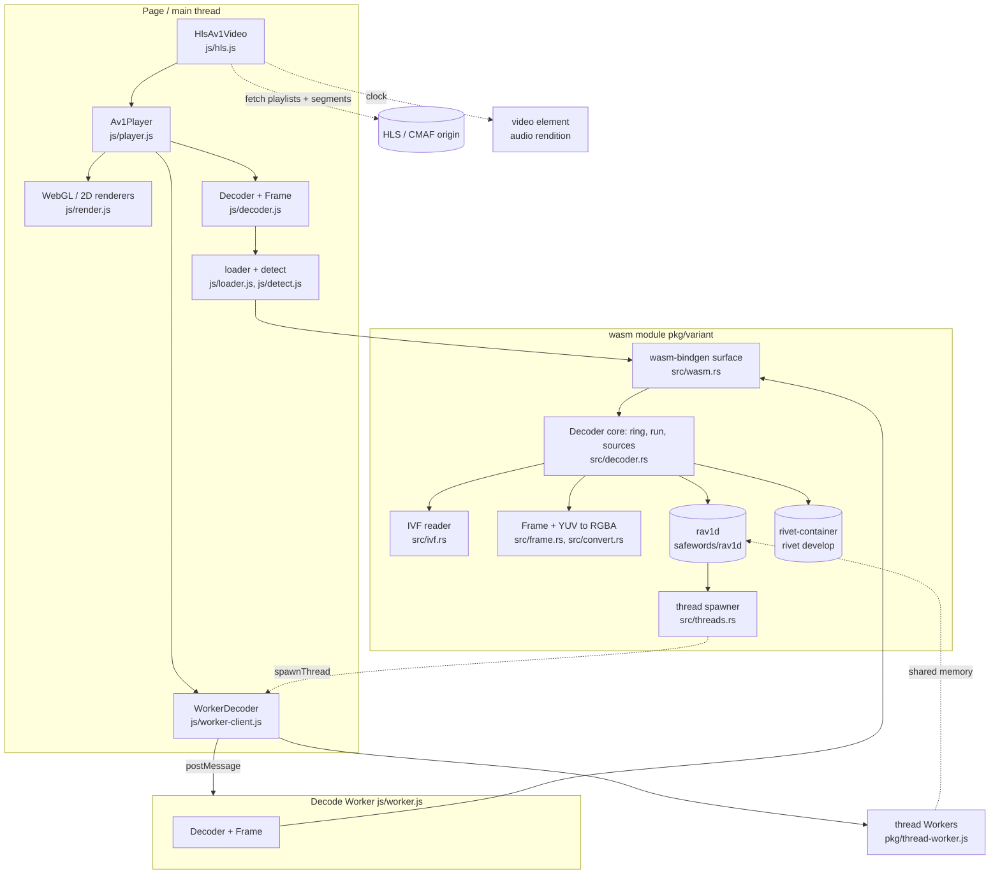

# wasm-av1: feature docs

> **Last verified against code:** 2026-11-06 @ `07e0968`

wasm-av1 is AV1 decoding for browsers that have no AV1 decoder of their own:
rav1d (the Rust port of dav1d, from the `safewords/rav1d` fork) compiled to
WebAssembly in four variants, with containers demuxed inside the same wasm by
rivet's `rivet-container`, behind a small pull-style API ported from
GoogleChromeLabs/wasm-av1. On top of the wasm sits an ESM JavaScript layer:
loader and feature detection, a `Decoder` wrapper, a decode Worker, WebGL and
2D renderers, `Av1Player` and `HlsAv1Video`. It is a library, not a service:
nothing deploys. A `v*` tag builds and publishes `@safewords/wasm-av1` to npm
and to a GitHub Release; lewd-frontend consumes the 0.2.2 release tarball by
URL. Pushing `main` only runs CI.

## Index

| Component | Status | Doc |
|---|---|---|
| Decoder core (ring, `run`, `finished`, flush) | PARTIAL (a truncated IVF frame loops) | [decoder-core.md](./decoder-core.md) |
| Input sources (IVF, containers via rivet, push, CMAF segments, rendition switch) | STABLE | [input-sources.md](./input-sources.md) |
| Frames, colour conversion and rendering | STABLE | [frames-and-rendering.md](./frames-and-rendering.md) |
| wasm variants, detection and threading | PARTIAL (thread Workers are never torn down) | [variants-and-threading.md](./variants-and-threading.md) |
| JS decoder API and the decode Worker | PARTIAL (stale frames after flush; `load` can hang) | [js-api-and-worker.md](./js-api-and-worker.md) |
| Av1Player and HlsAv1Video | STABLE | [player-and-hls.md](./player-and-hls.md) |
| Build, tests and release | PARTIAL (committed `pkg/` trails `main`) | [build-and-release.md](./build-and-release.md) |

Deeper material that predates these docs and stays authoritative for its
subject: [`../rav1d.md`](../rav1d.md) (the fork's commits),
[`../rivet.md`](../rivet.md) (the demuxer), [`../performance.md`](../performance.md)
(measurements), [`../integration.md`](../integration.md) (how a player should
adopt the fallback).

## Known defects

| Component | Defect | Severity |
|---|---|---|
| Decoder core | A truncated IVF frame makes `IvfReader::next_frame` fail without advancing (`src/ivf.rs:191-196`), so every later `run()` returns the same error and `finished` never becomes true. `Av1Player` and `worker.js` both treat a throw as `CONSUMED` and keep calling: a hot loop of `onerror` / `error` messages on a partly downloaded file. | Medium |
| JS API & Worker | `WorkerDecoder.flush()` / `setSource()` clear the page-side queue, but frames the Worker posted before it saw the message still arrive and are queued: a few frames of the old position or file are shown after a seek or reload. Messages carry no generation. | Medium |
| JS API & Worker | `Av1Player.load()` in Worker mode polls `src.info` (`js/player.js:129-133`); if the Worker rejects the source (not AV1, bad file) `info` never arrives and `load()` never settles. | Medium |
| Variants & threading | Thread Workers created by `spawnThreadWorker` are not tracked; `WorkerDecoder.close()` posts `close` and terminates the decode Worker at once (`js/worker-client.js:231-234`), so `free()` likely never runs and the thread Workers stay blocked on shared memory. Each destroyed threaded player can leak up to 8 Workers. Not reproduced. | Medium |
| Variants & threading | A thread Worker that fails to start or traps leaves the decoder waiting forever (`js/thread-worker.js:18-31`); the page sees only a console error. | Low |
| Build & release | The committed `pkg/` was last rebuilt at `527e95a` (0.2.2); `main` has since moved rivet to `2100c31` (IVF through `setSourceContainer`). A `github:safewords/wasm-av1#main` consumer gets the old wasm with the new JS. | Low |
| Build & release | `scripts/build.sh` does not run on a stock macOS: GNU-only sed expressions (`:42`, `:112`), empty arrays under `set -u` on bash 3.2 (`:67`), GNU `stat -c %s` (`:120`). | Low |
| Player & HLS | `_switchAtBoundary` locates the decoding segment by comparing cumulative pushed samples with `stats.temporalUnitsIn`, which is never reset by a flush and counts past the 64-entry `_pushed` window (`js/hls.js:332-338`, `438`). After a seek or 64 segments, a boundary switch lands after everything already pushed: correct, but up to `prefetchSeconds` late. | Low |
| Decoder core | `reset_state`'s doc comment says it creates a fresh rav1d instance; the code calls `rav1d`'s `flush()` (`src/decoder.rs:556-565`). The code is right (the fork's `6f780a0` fixed flush); the comment is stale. | Low |
