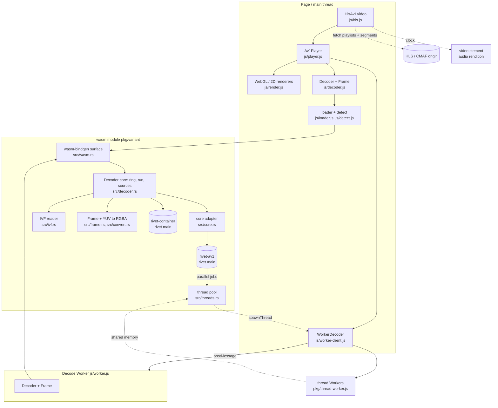

# wasm-av1: feature docs

> **Last verified against code:** 2026-11-13 @ the commit after `4aa6d72` (frames in flight); the index rows for speed and threading only, the rest as of 2026-11-12 @ `162385f`

wasm-av1 is AV1 decoding for browsers that have no AV1 decoder of their own:
rivet-av1 (rivet's own AV1 decoder, written from the specification) compiled
to WebAssembly in four variants, with containers demuxed inside the same wasm
by rivet's `rivet-container`, behind a small pull-style API ported from
GoogleChromeLabs/wasm-av1. On top of the wasm sits an ESM JavaScript layer:
loader and feature detection, a `Decoder` wrapper, a decode Worker, WebGL and
2D renderers, `Av1Player` and `HlsAv1Video`. It is a library, not a service:
nothing deploys. A `v*` tag builds and publishes `@safewords/wasm-av1` to npm
and to a GitHub Release; lewd-frontend consumes the 0.2.2 release tarball by
URL. Pushing `main` only runs CI.

Since 0.3.0 (2026-11-12) rivet-av1 is the only decoder; rav1d, which 0.1.0
to 0.2.2 were built on, is gone. As first built that made the package
slower (a third to two thirds of rav1d's single-thread rate in wasm, and
poor scaling with threads). **As measured on 2026-11-13, after the work in
rivet-av1, it is level with or ahead of rav1d** on 8-bit 720p and 1080p
video on one thread, and 1.3 times its rate on four and eight threads on
the one-tile streams most encoders make; with more than one thread its
frames come out a few temporal units late. A stream encoded with several
tiles per frame still scales worse than it did with rav1d. It is bit-exact
on every fixture in every variant.
[`../rivet-av1.md`](../rivet-av1.md) is the account, with the measurements
and rav1d as their baseline. lewd-frontend's 0.2.2 tarball is still the
rav1d build.

## Index

| Component | Status | Doc |
|---|---|---|
| Decoder core (ring, `run`, `finished`, flush) | PARTIAL (a truncated IVF frame loops) | [decoder-core.md](./decoder-core.md) |
| Input sources (IVF, containers via rivet, push, CMAF segments, rendition switch) | STABLE | [input-sources.md](./input-sources.md) |
| Frames, colour conversion and rendering | STABLE | [frames-and-rendering.md](./frames-and-rendering.md) |
| wasm variants, detection and threading | PARTIAL (a stream with several tiles per frame gains little from more than four threads) | [variants-and-threading.md](./variants-and-threading.md) |
| JS decoder API and the decode Worker | PARTIAL (stale frames after flush; `load` can hang) | [js-api-and-worker.md](./js-api-and-worker.md) |
| Av1Player and HlsAv1Video | STABLE | [player-and-hls.md](./player-and-hls.md) |
| Build, tests and release | PARTIAL (the committed `pkg/` is replaced from CI's build by hand, so it can trail `main` by a commit) | [build-and-release.md](./build-and-release.md) |

Deeper material that stays authoritative for its subject:
[`../rivet-av1.md`](../rivet-av1.md) (the decoder: what it is, what it
replaced, what was measured, what closed the gap and what is left),
[`../rivet.md`](../rivet.md) (the demuxer), [`../performance.md`](../performance.md)
(where 0.3.0 stands, and the rav1d measurements of 0.2.x as the baseline),
[`../integration.md`](../integration.md) (how a player should
adopt the fallback).

## Known defects

| Component | Defect | Severity |
|---|---|---|
| Variants & threading | **Thread scaling on streams with several tiles per frame.** Such frames are decoded one at a time, tiles in parallel and post-filters in bands, and are not part of rivet-av1's frame threading: an eight-tile 720p clip gains 2.1 times from eight threads and nothing from the last four, where rav1d reached 6.3 (0.39 of its rate on eight; measured 2026-11-13). One-tile streams, which are most video, gain 3.7 to 4.2 times and are ahead of rav1d. | Medium |
| Decoder core | **Output lags input with threads.** With more than one thread a unit's frames come out a few units later, and a damaged unit is reported late. A caller that drives `Decoder` itself and stops calling `run()` when it returns `STARVED` loses the frames still in flight until it feeds more or ends the stream; `unitsInFlight` is there to poll on, and the decode Worker does. | Low |
| Decoder core | A truncated IVF frame makes `IvfReader::next_frame` fail without advancing (`src/ivf.rs:191-196`), so every later `run()` returns the same error and `finished` never becomes true. `Av1Player` and `worker.js` both treat a throw as `CONSUMED` and keep calling: a hot loop of `onerror` / `error` messages on a partly downloaded file. | Medium |
| JS API & Worker | `WorkerDecoder.flush()` / `setSource()` clear the page-side queue, but frames the Worker posted before it saw the message still arrive and are queued: a few frames of the old position or file are shown after a seek or reload. Messages carry no generation. | Medium |
| JS API & Worker | `Av1Player.load()` in Worker mode polls `src.info` (`js/player.js:129-133`); if the Worker rejects the source (not AV1, bad file) `info` never arrives and `load()` never settles. | Medium |
| Variants & threading | A thread Worker that fails to start or traps leaves the decoder waiting forever (`js/thread-worker.js:19-32`); the page sees only a console error. | Low |
| Build & release | The committed `pkg/` is replaced only from CI's build, by hand, after the source commit that changes it. Between the two a `github:safewords/wasm-av1#main` consumer gets the previous wasm with the new JS (on 2026-11-13: the threads variants without `tools/wasm-copy-guard`, until CI's build of that commit is committed). | Low |
| Variants & threading | `test/browser.mjs` is not in CI (Playwright is not installed there). It was last run on 2026-11-13, on a local unoptimised build of 0.3.0 with `tools/wasm-copy-guard`: every combination passed in Chromium, Firefox and WebKit (Playwright 1.56's macOS WebKit and 1.62's). A regression in a browser shows up only when somebody runs it. | Medium |
| Build & release | `scripts/build.sh` does not run on a stock macOS: GNU-only sed expressions (`:48`, `:50`), empty arrays under `set -u` on bash 3.2 (`:75`), GNU `stat -c %s` (`:129`). | Low |
| Player & HLS | `_switchAtBoundary` locates the decoding segment by comparing cumulative pushed samples with `stats.temporalUnitsIn`, which is never reset by a flush and counts past the 64-entry `_pushed` window (`js/hls.js:332-338`, `438`). After a seek or 64 segments, a boundary switch lands after everything already pushed: correct, but up to `prefetchSeconds` late. | Low |
