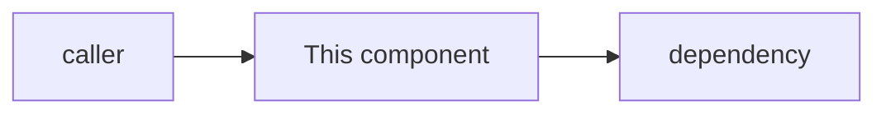

# <Component name>

> **Status:** STABLE | PARTIAL | LEGACY | PLANNED | DOC: STALE
> **Owners (code):** `src/…`, `src/…`
> **Related docs:** <other feature docs, cross-repo docs>
> **Last verified against code:** <YYYY-MM-DD> @ `<short sha>`

## Overview

One or two paragraphs: what this is, who uses it (a person, another
service, an operator), and where it sits in the system.

## How it works today

### Data model

Tables or stores this component owns: key columns, relationships, indexes,
soft deletes, which id it keys on.

### Interfaces

| Kind | Name / path | Auth | Handler | Notes |
|---|---|---|---|---|

HTTP routes, console commands, queue jobs, events, CLI flags, environment
variables: whatever its surface is.

### Flow

The lifecycle step by step with `path:line` references, golden path first,
then the branches that matter. A sequence or state diagram where it helps.

### Configuration

Environment variables and config keys, defaults, where production sets them
(the helm chart values).

### Edge cases & gotchas

Limits, auth subtleties, things that have burned someone before.

## History & references

Older docs, incident write-ups, plans, and the commits that shaped it.

## Proposed / Ideas (backlog)

| Idea | Motivation | Sketch | Status |
|---|---|---|---|
