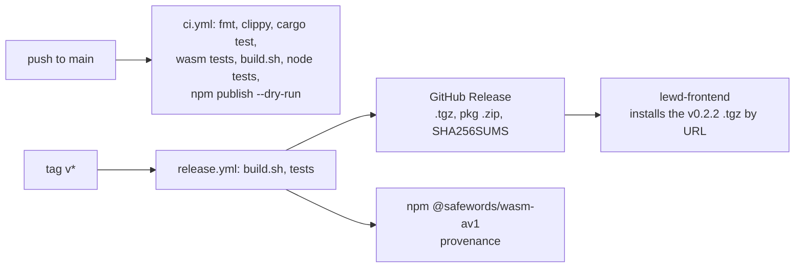

# Build, tests and release

> **Status:** PARTIAL — CI and release work; the committed `pkg/` trails `main`.
> **Owners (code):** `scripts/build.sh`, `.github/workflows/ci.yml`, `.github/workflows/release.yml`, `package.json`, `Cargo.toml`, `rust-toolchain.toml`, `tests/`, `test/`, `scripts/`
> **Related docs:** [variants-and-threading.md](./variants-and-threading.md), [`../performance.md`](../performance.md)
> **Last verified against code:** 2026-11-06 @ `07e0968`

## Overview

`scripts/build.sh` compiles the four variants and runs wasm-bindgen and
wasm-opt into `pkg/`. CI proves the decoder on every push to `main`; a `v*`
tag builds the tag, tests it, and publishes `@safewords/wasm-av1` to npm and
to a GitHub Release. `pkg/` is committed so that a git dependency carries the
wasm. Nothing here deploys a service.

## How it works today

### Interfaces

| Kind | Name | Notes |
|---|---|---|
| Script | `scripts/build.sh [--dev]` | `FEATURES=…` (e.g. `bitdepth_8`), `VARIANTS="simd simd-threads"`; checks wasm-bindgen-cli equals the `Cargo.lock` version (`scripts/build.sh:42-48`); writes `pkg/manifest.json` with sizes and the rav1d revision (`109-125`) |
| npm | `build`, `test`, `test:node`, `test:browser`, `bench`, `bench:browser`, `serve` | `package.json:53-61` |
| Workflow | `ci.yml` | `push` to `main`, `workflow_dispatch` (`.github/workflows/ci.yml:12-20`); `docs/**` and `**/*.md` are paths-ignored since `bad92a8`, so a docs-only push runs nothing |
| Workflow | `release.yml` | `push` of `v*` tags, or `workflow_dispatch` with a tag (`.github/workflows/release.yml:25-32`) |
| Secret | `NPM_TOKEN` (repository secret, optional) | Otherwise npm trusted publishing (OIDC); with neither the npm step warns and the release still succeeds (`release.yml:126-150`) |

Toolchain: Rust `1.99.1` with `rust-src` (`rust-toolchain.toml`),
wasm-bindgen-cli `0.2.130`, binaryen `version_123`, Node 22, mold for native
links (`ci.yml:21-33`). The threads variants rebuild std with
`-Zbuild-std` under `RUSTC_BOOTSTRAP=1` (`scripts/build.sh:60-67`).

### Flow: tests

| Command | Proves |
|---|---|
| `cargo test --release` (also without `container`) | Every fixture decodes to the libdav1d/libaom MD5, single and threaded; push ≡ IVF; MP4/fMP4/WebM ≡ IVF; CMAF segments and rendition switches (`tests/decode.rs`, `tests/container.rs`) |
| `cargo test --target wasm32-unknown-unknown --test wasm_convert` (± simd128) | RGBA dispatch equals scalar on 55 combinations inside wasm |
| `node --test test/decode.test.mjs` | The built `.wasm`, every variant: same MD5s, SIMD and baseline RGBA byte-identical, container and segment paths, rung switch through the JS `Decoder` |
| `node test/browser.mjs` (Playwright, not in CI) | Chromium, Firefox, WebKit × variants × renderers × thread/Worker × formats, on a cross-origin-isolated page |

`scripts/make-fixtures.sh` regenerates `testdata/` with ffmpeg; libdav1d and
libaom must agree or it aborts.

### Flow: release

`release.yml` checks the tag equals `package.json` and `Cargo.toml` versions
(`55-63`), builds, runs `cargo test` and the Node tests, `npm pack`s, zips
`pkg/`, writes `SHA256SUMS` and release notes with the rav1d and rivet
revisions, creates or updates the GitHub Release, and publishes to npm unless
that version already exists. To release: bump both versions, rebuild and
commit `pkg/`, tag `vX.Y.Z`, push the tag.

### Edge cases & gotchas

- **The committed `pkg/` trails `main`.** It was last rebuilt in `527e95a`
  (0.2.2). Since then `07e0968` moved rivet to `2100c31`; `pkg/manifest.json`
  records the rav1d revision but not rivet's. Consumers of the release tarball
  are unaffected (release.yml builds the tag itself); consumers of
  `github:safewords/wasm-av1#main` get 0.2.2 wasm with newer JS.
- CI's "does the committed `pkg/` match" step is a warning only: a Windows
  build and a Linux build differ in the paths embedded in panic strings
  (`ci.yml:98-104`).
- `scripts/build.sh:120` (and `release.yml:112`) use GNU `stat -c %s`; on
  macOS the script writes a manifest with empty `bytes`.
- The browser matrix needs Playwright (`PLAYWRIGHT_DIR`) and does not run in CI.
- A new Rust version cold-starts sccache: the first CI build after a bump is
  2-4x slower.

## History & references

- `bb53c54`: Rust 1.99.1 and mold for the native side.
- `ec0e315`: dependencies within semver, wasm-bindgen 0.2.130.
- The repository README's "Testing" and "Performance" sections, and
  [`../performance.md`](../performance.md).

## Proposed / Ideas (backlog)

| Idea | Motivation | Sketch | Status |
|---|---|---|---|
| Record rivet in the manifest | Know which demuxer a `pkg/` holds | Add `"rivet-container"` beside `"rav1d"` in `build.sh` | Proposed |
| Portable `stat` | Builds on macOS | `wc -c < file` | Proposed |
| Rebuild `pkg/` with each dependency bump | `main` consumers get what the source says | CI artifact committed by the release prep, or stop committing `pkg/` | Proposed |
