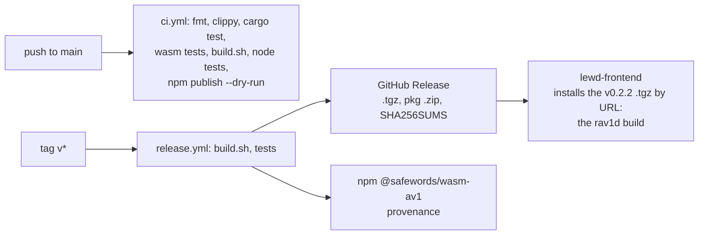

# Build, tests and release

> **Status:** PARTIAL — CI and release work; the committed `pkg/` is replaced from CI's build by hand, so it can trail `main` by a commit.
> **Owners (code):** `scripts/build.sh`, `.github/workflows/ci.yml`, `.github/workflows/release.yml`, `package.json`, `Cargo.toml`, `rust-toolchain.toml`, `tests/`, `test/`, `scripts/`
> **Related docs:** [variants-and-threading.md](./variants-and-threading.md), [`../performance.md`](../performance.md), [`../rivet-av1.md`](../rivet-av1.md)
> **Last verified against code:** 2026-11-12 @ `162385f`

## Overview

`scripts/build.sh` compiles the four variants and runs wasm-bindgen and
wasm-opt into `pkg/`; between the two, the threads variants go through
`tools/wasm-copy-guard` (a native tool with its own `Cargo.lock`, built by
the script), which works around a WebKit bug
([variants-and-threading.md](./variants-and-threading.md)). CI proves the decoder on every push to `main`; a `v*`
tag builds the tag, tests it, and publishes `@safewords/wasm-av1` to npm and
to a GitHub Release. `pkg/` is committed so that a git dependency carries the
wasm. Nothing here deploys a service.

## How it works today

### Interfaces

| Kind | Name | Notes |
|---|---|---|
| Script | `scripts/build.sh [--dev]` | `VARIANTS="simd simd-threads"` builds a subset. `FEATURES` unset builds the default features (`container`); set, even to nothing, it builds exactly the features it names, so `FEATURES= scripts/build.sh` leaves the demuxers out (`scripts/build.sh:36-46`). Checks wasm-bindgen-cli equals the `Cargo.lock` version (`50-56`); writes `pkg/manifest.json` with the version, `"core": "rivet-av1"`, the rivet revision `Cargo.lock` pins, the features and each variant's size (`116-134`) |
| npm | `build`, `test`, `test:node`, `test:browser`, `bench`, `bench:browser`, `serve` | `package.json:52-60` |
| Workflow | `ci.yml` | `push` to `main`, `workflow_dispatch` (`.github/workflows/ci.yml:12-20`); `docs/**` and `**/*.md` are paths-ignored since `bad92a8`, so a docs-only push runs nothing |
| Workflow | `release.yml` | `push` of `v*` tags, or `workflow_dispatch` with a tag (`.github/workflows/release.yml:25-32`) |
| Secret | `NPM_TOKEN` (repository secret, optional) | Otherwise npm trusted publishing (OIDC); with neither the npm step warns and the release still succeeds (`release.yml:126-150`) |

Toolchain: Rust `1.100.0` with `rust-src` (`rust-toolchain.toml`),
wasm-bindgen-cli `0.2.130`, binaryen `version_123`, Node 22, mold for native
links (`ci.yml:21-33`). The threads variants rebuild std with
`-Zbuild-std` under `RUSTC_BOOTSTRAP=1` (`scripts/build.sh:68-75`).

### Flow: tests

| Command | Proves |
|---|---|
| `cargo test --release` (also `--no-default-features`, without `container`) | Every fixture decodes to the libdav1d/libaom MD5 on 1, 2 and 4 threads; film grain on and off; push ≡ IVF; MP4/fMP4/WebM ≡ IVF; CMAF segments and rendition switches (`tests/decode.rs`, `tests/container.rs`) |
| `cargo test --target wasm32-unknown-unknown --test wasm_convert` (± simd128) | RGBA dispatch equals scalar on 55 combinations inside wasm |
| `node --test test/decode.test.mjs` | The built `.wasm`, all four variants: same MD5s in baseline and SIMD, with `applyGrain` false too; the `threads` and `simd-threads` builds on 1, 2, 4 and 8 threads, each wasm thread a `worker_threads` Worker (`test/threads-node.mjs`, one process per run so a decoder left waiting fails instead of hanging); SIMD and baseline RGBA byte-identical; container and segment paths; rung switch through the JS `Decoder`. 20 tests |
| `node --test test/copy-guard.test.mjs` (builds `tools/wasm-copy-guard` with cargo) | The pass the threads variants get: the instructions become calls, and both paths of its helpers (the instruction, and the load/store loops) behave as memmove/memset and still trap out of bounds |
| `node test/browser.mjs` (Playwright, not in CI) | Chromium, Firefox, WebKit × variants × renderers × thread/Worker × formats, on a cross-origin-isolated page |

`scripts/make-fixtures.sh` regenerates `testdata/` with ffmpeg; libdav1d and
libaom must agree or it aborts.

### Flow: release

`release.yml` checks the tag equals `package.json` and `Cargo.toml` versions
(`55-63`), builds, runs `cargo test` and the Node tests, `npm pack`s, zips
`pkg/`, writes `SHA256SUMS` and release notes with the rivet revision,
creates or updates the GitHub Release, and publishes to npm unless
that version already exists. To release: bump both versions, rebuild and
commit `pkg/`, tag `vX.Y.Z`, push the tag.

### Edge cases & gotchas

- **The committed `pkg/` can trail `main` by a commit.** It is replaced only
  from CI's build (the pinned `wasm-opt`), never from a local one, by hand,
  after the source commit that changes the wasm. As of `2a97faf` it is CI's
  build of that commit (0.3.0, rivet-av1 `03054ad`). Between a source commit
  and the `pkg/` commit that follows it, consumers of the release tarball
  are unaffected (release.yml builds the tag itself) and consumers of
  `github:safewords/wasm-av1#main` get the previous wasm with newer JS; the
  JS tolerates that where it can (`unitsInFlight` reads as 0 on a wasm that
  lacks it).
- CI's "does the committed `pkg/` match" step is a warning only: a Windows
  build and a Linux build differ in the paths embedded in panic strings
  (`ci.yml:98-104`).
- `scripts/build.sh` does not run on a stock macOS (run 2026-11-12): BSD sed
  rejects the `{n;s/…/p}` expressions (`scripts/build.sh:48`, `:50`) and the
  script exits there; `/bin/bash` 3.2 then refuses the empty arrays under
  `set -u` (`:75`); and `:129` (with `release.yml:112`) uses GNU
  `stat -c %s`. CI runs it on Linux, where all three are fine. It does run
  there unmodified as `zsh --emulate ksh scripts/build.sh` (zsh accepts the
  empty arrays and, emulating ksh, splits `$VARIANTS` as sh does) with two
  shims first on `PATH`: a `sed` that rewrites `p}` to `p;}` before calling
  `/usr/bin/sed`, and a `stat` that calls coreutils' `gstat`. All four
  variants were built that way on 2026-11-12, for 0.3.0 and, before it, for
  both decoder cores.
- **Without `wasm-opt` the `.wasm` is about twice the size.** `build.sh`
  says "~15% smaller"; measured on 2026-11-12 with rav1d, the baseline
  variant was 3 499 115 bytes without binaryen against the 1 700 331 CI
  shipped in 0.2.2. That gap was not `wasm-opt`: 0.2.2 was built in August,
  before the rivet-container update of 2026-11-06, and CI's build of the last
  rav1d commit on 2026-11-12 was 3 302 417. 0.3.0 is 3 026 836 without
  binaryen and 2 862 132 from CI, about 5% off, and the README's size table
  is CI's build. Compare sizes only between builds made the same way.
- The threads variants pass `-C target-feature=+atomics`, which is not a
  stable target feature. rustc has always warned; from 1.100.0 the warning
  adds that it "will become a hard error in a future release"
  (rust-lang/rust#162235). The build still succeeds under
  `RUSTC_BOOTSTRAP=1`; read that issue before the next toolchain bump.
- Nothing reaches into Cargo's build directory. `build.sh` reads only the
  final `target/wasm-<variant>/wasm32-unknown-unknown/<profile>/wasm_av1.wasm`
  (`scripts/build.sh:76`), which Cargo 1.100's new layout for intermediate
  artifacts did not move.
- `.cargo/config.toml` sets a 7-day dependency cooldown
  (`global-min-publish-age`): `cargo update` and `cargo add` skip crates.io
  versions younger than that. It does not apply to the two git dependencies
  or to builds from `Cargo.lock`.
- The browser matrix needs Playwright (`PLAYWRIGHT_DIR`) and does not run in CI.
- A new Rust version cold-starts sccache: the first CI build after a bump is
  2-4x slower.

## History & references

- 2026-11-12: Rust 1.100.0 (toolchain file, both workflows) and the
  dependency cooldown. No source change was needed.
- `bb53c54`: Rust 1.99.1 and mold for the native side.
- `ec0e315`: dependencies within semver, wasm-bindgen 0.2.130.
- 2026-11-12: rivet-av1 as a second decoder core behind `rivet-av1` and
  `rivet-av1-pending` features, then, the same day, as the only one (0.3.0):
  rav1d, those two features and `bitdepth_8` / `bitdepth_16` removed;
  `FEATURES=` for a build without the demuxers; the threads variants tested
  in Node. [`../rivet-av1.md`](../rivet-av1.md).
- The repository README's "Testing" and "Performance" sections, and
  [`../performance.md`](../performance.md).

## Proposed / Ideas (backlog)

| Idea | Motivation | Sketch | Status |
|---|---|---|---|
| Portable `build.sh` | Builds on macOS | `wc -c < file` for `stat`; `p;}` in the sed expressions; `${arr[@]+"${arr[@]}"}` for the empty arrays | Proposed |
| Rebuild `pkg/` with each dependency bump | `main` consumers get what the source says | CI artifact committed by the release prep, or stop committing `pkg/` | Proposed |
