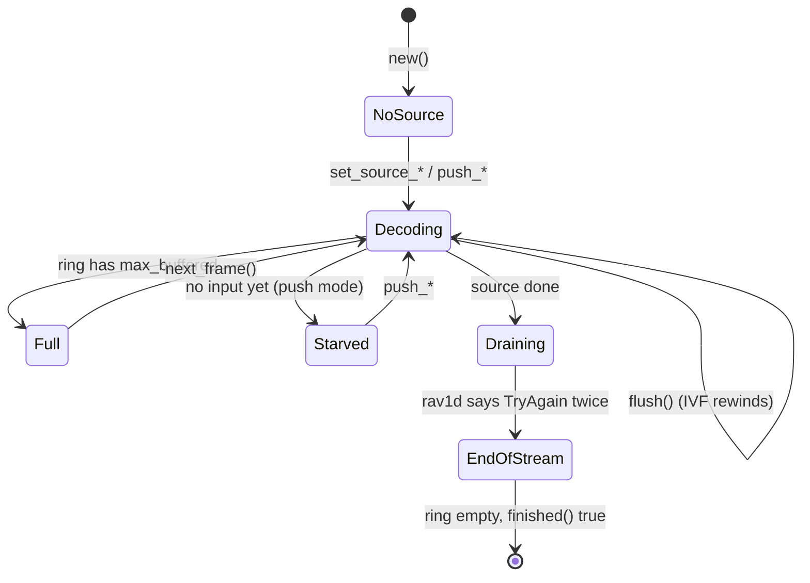

# Decoder core

> **Status:** PARTIAL — bit-exact and well tested; a truncated IVF frame turns `run()` into an endless error.
> **Owners (code):** `src/decoder.rs`, `src/core_rav1d.rs`, `src/core_rivet.rs`, `src/wasm.rs`, `src/lib.rs`
> **Related docs:** [input-sources.md](./input-sources.md), [frames-and-rendering.md](./frames-and-rendering.md), [variants-and-threading.md](./variants-and-threading.md), [`../rav1d.md`](../rav1d.md), [`../rivet-av1.md`](../rivet-av1.md)
> **Last verified against code:** 2026-11-12 @ `4386183`

## Overview

`Decoder` wraps one decoder core and a ring of decoded frames, driven the
way upstream wasm-av1 drove libaom: the caller asks for a bounded step of work
(`run`), pops frames (`next_frame`), and asks whether it is done (`finished`).
That pull shape suits a `requestAnimationFrame` loop on a main thread and a
pump loop in a Worker alike. If you know dav1d's `send_data` / `get_picture`,
this is that loop with a ring in front of it and the `EAGAIN` bookkeeping done
for you. The same Rust type is used natively (tests, `examples/decode_ivf.rs`)
and in wasm through `Av1Decoder` (`src/wasm.rs:88-528`).

The core is **rav1d** unless the crate is built with the non-default
`rivet-av1` Cargo feature, which compiles rivet's own AV1 decoder in its
place. Each sits behind the same five calls (`open`, `flush`, `send`,
`send_pending`, `picture`) in a private `core` module — `src/core_rav1d.rs`
or `src/core_rivet.rs`, chosen in `src/lib.rs:43-52` — and nothing else in
the crate names either. This doc describes the default; where rivet-av1
differs it says so, and [`../rivet-av1.md`](../rivet-av1.md) has the whole
story (what it lacks, what was measured, why it is not the default).

## How it works today

### Data model

`Decoder` (`src/decoder.rs:195-237`) holds:

- `inner`: the core. rav1d is opened by `Core::open`
  (`src/core_rav1d.rs:24-41`) with `n_threads`, `apply_grain`, and
  `max_frame_delay` 1 when single-threaded or 0 (rav1d's own choice) when
  threaded. rivet-av1's `Core` (`src/core_rivet.rs:24-106`) holds an
  `av1::Decoder` and the frames of the last temporal unit: it decodes a unit
  in one call, so nothing is ever pending or in flight.
- `source`: `Ivf`, `Container` or `Push` (`src/decoder.rs:147-160`); see
  [input-sources.md](./input-sources.md).
- `ring: VecDeque<Frame>`, capped at `Config::max_buffered` (default 10,
  upstream's `NUM_FRAMES_BUFFERED`, `src/decoder.rs:41`), and `current`, the
  frame last popped, which stays readable until the next pop.
- State flags: `drained`, `input_pending` (rav1d returned `TryAgain` from
  `send_data`), `needs_drain` (frames may be in flight in worker threads).
  With rivet-av1 the last two never stay set.
- `Stats` (`src/decoder.rs:134-140`): temporal units in, bytes in, frames out,
  decode errors. Never reset, including by `flush`.

### Interfaces

| Kind | Name | Notes |
|---|---|---|
| Rust | `Decoder::new(Config)` | `Config { max_buffered, apply_grain, threads }` (`src/decoder.rs:43-68`) |
| Rust | `run() -> RunOutcome` | `Full`, `Consumed`, `Starved`, `EndOfStream` (`src/decoder.rs:119-131`) |
| Rust | `run_until_full()` | `run` until anything but `Consumed` (`src/decoder.rs:788-795`) |
| Rust | `next_frame`, `peek_next`, `current_frame`, `take_current_frame` | `src/decoder.rs:766-785` |
| Rust | `finished()` | `src/decoder.rs:582-588` |
| Rust | `flush()` | `src/decoder.rs:529-542` |
| wasm | `new Av1Decoder(maxBuffered?, applyGrain?, threads?)` | `src/wasm.rs:105-122`; `threads()` reports what applied |
| wasm | `run`, `runUntilFull`, `framesBuffered`, `finished`, `stats`, `flush` | `src/wasm.rs:274-314`; `RunResult` is the enum as 0-3 (`src/wasm.rs:53-60`) |
| wasm | `width`, `height`, `timeBaseNum/Den`, `frameCountHint`, `frameRateHint`, `durationHint` | `src/wasm.rs:318-376` |
| wasm | `simdEnabled`, `threadsSupported`, `containerSupport`, `version` | free functions, `src/wasm.rs:25-50` |

Errors (`src/decoder.rs:70-109`): `Ivf`, `NotAv1`, `Container`, `Open`,
`Decode` (the temporal unit is dropped, the decoder stays usable), `NoSource`,
`WrongMode`. `Open` and `Decode` carry the core's own error, exported as
`wasm_av1::CoreError`: `rav1d::Rav1dError`, or `av1::Error` in a `rivet-av1`
build. In wasm every error becomes a thrown `JsError` with the `Display`
text, which begins with the core's name (`rav1d: …` or `rivet-av1: …`).

### Flow

`run()` (`src/decoder.rs:622-712`), in order:

1. No source: `NoSource`. Ring full: `Full`, nothing read.
2. Pictures the last call could not fit go into the ring first (`631-636`).
3. If rav1d still holds part of the last input (`input_pending`), offer it
   again with `send_pending` and collect pictures (`639-654`).
4. Take the next temporal unit from the source (`657-675`). None available:
   collect, and if the source is done run `drain_in_flight` (`720-734`), which
   calls `get_picture` until rav1d answers `TryAgain` in its drain state. That
   returns `EndOfStream` once everything is out, else `Starved`.
5. Otherwise `send(data, pts)`, then `collect_pictures` (`742-760`), and
   return `Consumed`. A `Decode` error counts in `decode_errors` and
   propagates.

`finished()` is stricter than upstream's: source done **and** nothing pending
**and** drained **and** the ring empty, so a player does not stop with frames
still buffered (`src/decoder.rs:25-28`). It settles one `run()` after the last
input.

`flush()` calls `reset_state` (`src/decoder.rs:548-562`: the core's `flush`,
ring and flags cleared, and the sequence-header flag re-armed for CMAF) and
then: IVF rewinds, a container source is **dropped** (rivet is
forward-only), push mode clears its queue. rav1d's flush keeps its worker
threads, so a seek does not respawn Workers; rivet-av1's `flush` is a new
`av1::Decoder`, and its threads belong to a pool that outlives it
(`src/core_rivet.rs:69-77`).

### Configuration

Cargo features (`Cargo.toml:60-83`): `bitdepth_8`, `bitdepth_16` (rav1d's
sample depths, and what links rav1d in; dropping `bitdepth_16` shrinks the
wasm if every stream is 8-bit), `container` (rivet). All on by default.
`rivet-av1` (off) swaps the core, and `rivet-av1-pending` (off) adds the parts
of that core that need rivet-av1 commits not yet upstream; a rivet-av1 build
takes `--no-default-features` so rav1d is left out, and decodes every depth
whatever the `bitdepth_*` features say. The release profile is fat LTO, one
codegen unit, `panic = "abort"` (`Cargo.toml:85-91`), so a panic in wasm is a
trap, not an exception.

### Edge cases & gotchas

- **A truncated IVF frame never clears.** `IvfReader::next_frame` returns
  `TruncatedFrame` without moving its cursor (`src/ivf.rs:176-196`), and
  `is_empty` is false while 12 bytes remain (`src/ivf.rs:160-162`). Every
  later `run()` fails the same way; `finished()` stays false. The callers in
  `js/` retry on error, so this becomes a busy loop. Fix: mark the reader
  exhausted on a framing error, or skip to the end.
- `Stats` survive `flush()`; consumers that compare them with their own
  counters after a seek (see `js/hls.js`) drift.
- `pushTemporalUnit`'s `pts` crosses the wasm boundary as `f64` and is cast to
  `i64` (`src/wasm.rs:205-208`); `NaN` becomes 0.
- **With `rivet-av1`, a damaged frame is not concealed.** rivet-av1 returns
  an error and decoding resumes cleanly at the next keyframe; rav1d carries
  on with what it has. Either way the temporal unit counts in
  `decode_errors` and the decoder stays usable
  (`tests/decode.rs`, `a_unit_that_lost_its_tiles_costs_no_more_than_its_gop`).
- `src/core_rivet.rs:80-92` puts a temporal delimiter in front of every unit
  it hands rivet-av1. MP4 and Matroska samples come without one, and
  rivet-av1 only forgets an unfinished frame when it sees one: measured on
  an SVT-AV1 stream, a single unit cut after its frame header made every
  later unit fail with "OBU_FRAME while a frame is in progress".
- rav1d's C API (`dav1d_open`, `dav1d_send_data`, …, 29 symbols) is exported
  from the built `.wasm`: rav1d marks it `#[no_mangle]` and a `cdylib` keeps
  such symbols. Nothing calls it. It also means a build with both
  `rivet-av1` and a `bitdepth_*` feature carries all of rav1d as dead weight.

## History & references

- [`../rav1d.md`](../rav1d.md): the fork's commits, including the panic fix
  for damaged temporal units (`74f87c8`) and the flush fix (`6f780a0`).
- [`../rivet-av1.md`](../rivet-av1.md): rivet's AV1 decoder as a second
  core, 2026-11-12. The core was split out of `decoder.rs` and `frame.rs`
  into `src/core_rav1d.rs` then; `Frame::from_picture` lives there now.
- Upstream: GoogleChromeLabs/wasm-av1 `decode-av1.c` (`AVX_Decoder_*`).
- `tests/decode.rs`: every fixture matches the libdav1d/libaom MD5, single and
  multi-threaded; push mode equals IVF mode. The same tests pass with either
  core.

## Proposed / Ideas (backlog)

| Idea | Motivation | Sketch | Status |
|---|---|---|---|
| Exhaust the IVF reader on a framing error | Ends the error loop | Set `pos = data.len()` before returning `TruncatedFrame`/`FrameTooLarge`; test with a cut fixture | Proposed |
| Reset `Stats` on source change | Comparable counters after a seek | Zero in `reset_state`, or expose a `since_reset` copy | Proposed |
