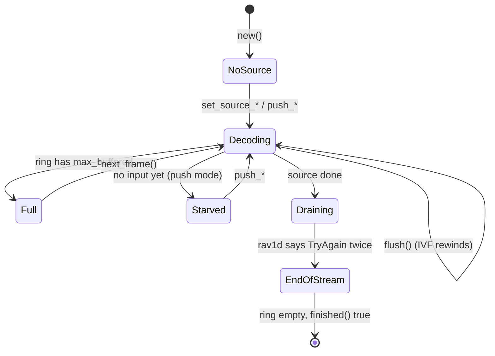

# Decoder core

> **Status:** PARTIAL — bit-exact and well tested; a truncated IVF frame turns `run()` into an endless error.
> **Owners (code):** `src/decoder.rs`, `src/wasm.rs`, `src/lib.rs`
> **Related docs:** [input-sources.md](./input-sources.md), [frames-and-rendering.md](./frames-and-rendering.md), [variants-and-threading.md](./variants-and-threading.md), [`../rav1d.md`](../rav1d.md)
> **Last verified against code:** 2026-11-06 @ `07e0968`

## Overview

`Decoder` wraps one `rav1d::Decoder` and a ring of decoded frames, driven the
way upstream wasm-av1 drove libaom: the caller asks for a bounded step of work
(`run`), pops frames (`next_frame`), and asks whether it is done (`finished`).
That pull shape suits a `requestAnimationFrame` loop on a main thread and a
pump loop in a Worker alike. If you know dav1d's `send_data` / `get_picture`,
this is that loop with a ring in front of it and the `EAGAIN` bookkeeping done
for you. The same Rust type is used natively (tests, `examples/decode_ivf.rs`)
and in wasm through `Av1Decoder` (`src/wasm.rs:88-528`).

## How it works today

### Data model

`Decoder` (`src/decoder.rs:190-232`) holds:

- `inner`: the rav1d decoder, opened by `open_rav1d` (`src/decoder.rs:243-258`)
  with `n_threads`, `apply_grain`, and `max_frame_delay` 1 when single-threaded
  or 0 (rav1d's own choice) when threaded.
- `source`: `Ivf`, `Container` or `Push` (`src/decoder.rs:142-155`); see
  [input-sources.md](./input-sources.md).
- `ring: VecDeque<Frame>`, capped at `Config::max_buffered` (default 10,
  upstream's `NUM_FRAMES_BUFFERED`, `src/decoder.rs:37`), and `current`, the
  frame last popped, which stays readable until the next pop.
- State flags: `drained`, `input_pending` (rav1d returned `TryAgain` from
  `send_data`), `needs_drain` (frames may be in flight in worker threads).
- `Stats` (`src/decoder.rs:129-135`): temporal units in, bytes in, frames out,
  decode errors. Never reset, including by `flush`.

### Interfaces

| Kind | Name | Notes |
|---|---|---|
| Rust | `Decoder::new(Config)` | `Config { max_buffered, apply_grain, threads }` (`src/decoder.rs:39-63`) |
| Rust | `run() -> RunOutcome` | `Full`, `Consumed`, `Starved`, `EndOfStream` (`src/decoder.rs:116-126`) |
| Rust | `run_until_full()` | `run` until anything but `Consumed` (`src/decoder.rs:808-815`) |
| Rust | `next_frame`, `peek_next`, `current_frame`, `take_current_frame` | `src/decoder.rs:786-805` |
| Rust | `finished()` | `src/decoder.rs:598-604` |
| Rust | `flush()` | `src/decoder.rs:541-554` |
| wasm | `new Av1Decoder(maxBuffered?, applyGrain?, threads?)` | `src/wasm.rs:105-122`; `threads()` reports what applied |
| wasm | `run`, `runUntilFull`, `framesBuffered`, `finished`, `stats`, `flush` | `src/wasm.rs:274-314`; `RunResult` is the enum as 0-3 (`src/wasm.rs:53-60`) |
| wasm | `width`, `height`, `timeBaseNum/Den`, `frameCountHint`, `frameRateHint`, `durationHint` | `src/wasm.rs:318-376` |
| wasm | `simdEnabled`, `threadsSupported`, `containerSupport`, `version` | free functions, `src/wasm.rs:25-50` |

Errors (`src/decoder.rs:65-104`): `Ivf`, `NotAv1`, `Container`, `Open`,
`Decode` (the temporal unit is dropped, the decoder stays usable), `NoSource`,
`WrongMode`. In wasm every error becomes a thrown `JsError` with the
`Display` text.

### Flow

`run()` (`src/decoder.rs:638-731`), in order:

1. No source: `NoSource`. Ring full: `Full`, nothing read.
2. Pictures the last call could not fit go into the ring first (`647-652`).
3. If rav1d still holds part of the last input (`input_pending`), offer it
   again with `send_pending_data` and collect pictures (`655-670`).
4. Take the next temporal unit from the source (`673-691`). None available:
   collect, and if the source is done run `drain_in_flight` (`733-752`), which
   calls `get_picture` until rav1d answers `TryAgain` in its drain state. That
   returns `EndOfStream` once everything is out, else `Starved`.
5. Otherwise `send_data(data, pts)`, then `collect_pictures` (`762-780`), and
   return `Consumed`. A `Decode` error counts in `decode_errors` and
   propagates.

`finished()` is stricter than upstream's: source done **and** nothing pending
**and** drained **and** the ring empty, so a player does not stop with frames
still buffered (`src/decoder.rs:20-23`). It settles one `run()` after the last
input.

`flush()` calls `reset_state` (rav1d's `flush`, ring and flags cleared, and
the sequence-header flag re-armed for CMAF) and then: IVF rewinds, a container
source is **dropped** (rivet is forward-only), push mode clears its queue.
rav1d's flush keeps its worker threads, so a seek does not respawn Workers.

### Configuration

Cargo features (`Cargo.toml:47-54`): `bitdepth_8`, `bitdepth_16` (dropping it
shrinks the wasm if every stream is 8-bit), `container` (rivet). All on by
default. The release profile is fat LTO, one codegen unit, `panic = "abort"`
(`Cargo.toml:56-62`), so a panic in wasm is a trap, not an exception.

### Edge cases & gotchas

- **A truncated IVF frame never clears.** `IvfReader::next_frame` returns
  `TruncatedFrame` without moving its cursor (`src/ivf.rs:176-196`), and
  `is_empty` is false while 12 bytes remain (`src/ivf.rs:160-162`). Every
  later `run()` fails the same way; `finished()` stays false. The callers in
  `js/` retry on error, so this becomes a busy loop. Fix: mark the reader
  exhausted on a framing error, or skip to the end.
- `Stats` survive `flush()`; consumers that compare them with their own
  counters after a seek (see `js/hls.js`) drift.
- `reset_state`'s doc comment (`src/decoder.rs:556-559`) describes a fresh
  rav1d instance; the code uses rav1d's `flush()`, which the fork's `6f780a0`
  made safe. Trust the code.
- `pushTemporalUnit`'s `pts` crosses the wasm boundary as `f64` and is cast to
  `i64` (`src/wasm.rs:205-208`); `NaN` becomes 0.
- The `lib.rs` header says the crate "builds three ways" and lists four, and
  its module table omits `threads` (`src/lib.rs:7-31`).

## History & references

- [`../rav1d.md`](../rav1d.md): the fork's commits, including the panic fix
  for damaged temporal units (`74f87c8`) and the flush fix (`6f780a0`).
- Upstream: GoogleChromeLabs/wasm-av1 `decode-av1.c` (`AVX_Decoder_*`).
- `tests/decode.rs`: every fixture matches the libdav1d/libaom MD5, single and
  multi-threaded; push mode equals IVF mode.

## Proposed / Ideas (backlog)

| Idea | Motivation | Sketch | Status |
|---|---|---|---|
| Exhaust the IVF reader on a framing error | Ends the error loop | Set `pos = data.len()` before returning `TruncatedFrame`/`FrameTooLarge`; test with a cut fixture | Proposed |
| Reset `Stats` on source change | Comparable counters after a seek | Zero in `reset_state`, or expose a `since_reset` copy | Proposed |
