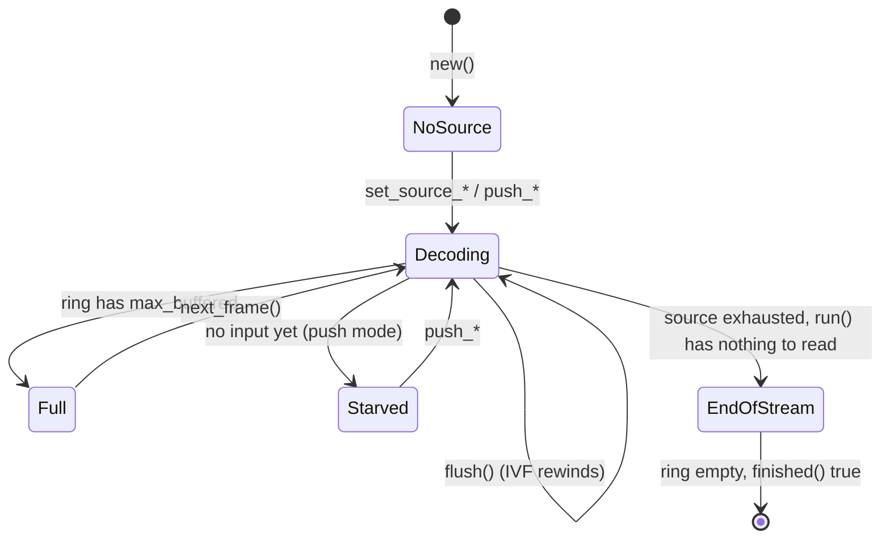

# Decoder core

> **Status:** PARTIAL — bit-exact and well tested, but slow next to the decoder it replaced; a truncated IVF frame turns `run()` into an endless error.
> **Owners (code):** `src/decoder.rs`, `src/core.rs`, `src/wasm.rs`, `src/lib.rs`
> **Related docs:** [input-sources.md](./input-sources.md), [frames-and-rendering.md](./frames-and-rendering.md), [variants-and-threading.md](./variants-and-threading.md), [`../rivet-av1.md`](../rivet-av1.md), [`../performance.md`](../performance.md)
> **Last verified against code:** 2026-11-12 @ `162385f`

## Overview

`Decoder` wraps the AV1 decoder and a ring of decoded frames, driven the way
upstream wasm-av1 drove libaom: the caller asks for a bounded step of work
(`run`), pops frames (`next_frame`), and asks whether it is done (`finished`).
That pull shape suits a `requestAnimationFrame` loop on a main thread and a
pump loop in a Worker alike. The same Rust type is used natively (tests,
`examples/decode_ivf.rs`) and in wasm through `Av1Decoder`
(`src/wasm.rs:88-528`).

The decoder underneath is **rivet-av1**, rivet's own AV1 decoder, and since
0.3.0 the only one: rav1d, the core of 0.1.0 to 0.2.2, was removed. It sits
behind four calls (`open`, `flush`, `send`, `picture`) in the private
`core` module (`src/core.rs`), which with the thread pool in
`src/threads.rs` is all of the crate that names it.

**It is slower than rav1d was.** Measured on 2026-11-12, in wasm on one
thread, rivet-av1 decodes 8-bit video at a third to two thirds of rav1d's
rate (0.33 to 0.63 times; 10-bit comes within a few percent in the SIMD
variant), and it gains little from threads on a stream with one tile per
frame (1.2 to 1.3 times on eight, where rav1d gained 2.8 to 3.6). The
performance work is under way in rivet-av1;
[`../rivet-av1.md`](../rivet-av1.md) has every number, with rav1d as the
baseline.

## How it works today

### Data model

`Decoder` (`src/decoder.rs:198-231`) holds:

- `inner`: the core (`src/core.rs:26-32`): an `av1::Decoder`, the thread
  count and grain switch it was opened with, and `ready`, the frames the
  last temporal unit showed that `Decoder` has not pulled yet. rivet-av1
  decodes a unit in one call, so nothing is ever half taken or in flight.
- `source`: `Ivf`, `Container` or `Push` (`src/decoder.rs:150-163`); see
  [input-sources.md](./input-sources.md).
- `ring: VecDeque<Frame>`, capped at `Config::max_buffered` (default 10,
  upstream's `NUM_FRAMES_BUFFERED`, `src/decoder.rs:41`), and `current`, the
  frame last popped, which stays readable until the next pop.
- `Stats` (`src/decoder.rs:138-143`): temporal units in, bytes in, frames out,
  decode errors. Never reset, including by `flush`.

### Interfaces

| Kind | Name | Notes |
|---|---|---|
| Rust | `Decoder::new(Config)` | `Config { max_buffered, apply_grain, threads }` (`src/decoder.rs:44-69`). Returns `Result`, and cannot fail with this core (`243-264`) |
| Rust | `run() -> RunOutcome` | `Full`, `Consumed`, `Starved`, `EndOfStream` (`src/decoder.rs:124-134`) |
| Rust | `run_until_full()` | `run` until anything but `Consumed` (`src/decoder.rs:700-707`) |
| Rust | `next_frame`, `peek_next`, `current_frame`, `take_current_frame` | `src/decoder.rs:678-697` |
| Rust | `finished()` | `src/decoder.rs:568-570` |
| Rust | `flush()` | `src/decoder.rs:519-532` |
| wasm | `new Av1Decoder(maxBuffered?, applyGrain?, threads?)` | `src/wasm.rs:105-122`; `threads()` reports what applied |
| wasm | `run`, `runUntilFull`, `framesBuffered`, `finished`, `stats`, `flush` | `src/wasm.rs:274-314`; `RunResult` is the enum as 0-3 (`src/wasm.rs:53-60`) |
| wasm | `width`, `height`, `timeBaseNum/Den`, `frameCountHint`, `frameRateHint`, `durationHint` | `src/wasm.rs:318-376` |
| wasm | `simdEnabled`, `threadsSupported`, `containerSupport`, `version` | free functions, `src/wasm.rs:25-50` |

`Config::apply_grain` (default true) is rivet-av1's
`Decoder::set_apply_grain`: off, a frame comes out as decoded, without the
film grain its stream asks for (`src/core.rs:34-39`). `Config::threads` is
the number of threads the core decodes one frame with, tiles in parallel
and the post-filters in bands; on wasm it is forced to 1 unless the build
has atomics (`effective_threads`, `src/decoder.rs:234-240`; see
[variants-and-threading.md](./variants-and-threading.md)).

Errors (`src/decoder.rs:72-112`): `Ivf`, `NotAv1`, `Container`, `Open`,
`Decode` (the temporal unit is dropped, the decoder stays usable), `NoSource`,
`WrongMode`. `Decode` carries the core's own error, exported as
`wasm_av1::CoreError`: `av1::Error`, which is `Bitstream`, `Unsupported` or
`InvalidInput` with a message (`src/core.rs:18`). `Open` is never returned
today: nothing in rivet-av1 can fail when a decoder is created. In wasm
every error becomes a thrown `JsError` with the `Display` text, which for a
decode error begins `rivet-av1: `.

### Flow

`run()` (`src/decoder.rs:604-659`), in order:

1. No source: `NoSource`. Ring full: `Full`, nothing read.
2. Frames of the last unit that did not fit go into the ring first; if that
   fills it, `Full` (`612-616`).
3. Take the next temporal unit from the source (`618-637`). None available:
   `EndOfStream` if the source is exhausted, else `Starved` (`639-647`).
4. Otherwise `send(data, pts)`: the core puts a temporal delimiter in front,
   decodes the unit, and stamps the unit's pts on every frame it shows
   (`src/core.rs:69-81`). Then `collect_pictures` (`src/decoder.rs:663-672`)
   moves them into the ring as far as it has room, and `run` returns
   `Consumed`. A `Decode` error counts in `decode_errors` and propagates.

`finished()` is stricter than upstream's: source exhausted **and** every
decoded frame popped, so a player does not stop with frames still buffered
(`src/decoder.rs:25-28`). There is no end-of-input drain any more (rav1d's
frame threads needed one), so it is true as soon as the last frame is
popped, without a further `run()`.

`flush()` calls `reset_state` (`src/decoder.rs:538-549`: the core's `flush`,
ring cleared, and the sequence-header flag re-armed for CMAF) and then: IVF
rewinds, a container source is **dropped** (rivet is forward-only), push mode
clears its queue. The core's `flush` is a new `av1::Decoder`
(`src/core.rs:61-64`); its threads belong to a pool that outlives it, so a
seek does not respawn Workers.

### Configuration

Cargo features (`Cargo.toml:42-45`): `container` (rivet's demuxers), on by
default, and nothing else. The decoder is not optional and has no build
options: the `bitdepth_8` / `bitdepth_16` features of 0.2.x selected rav1d's
sample depths and went with it; rivet-av1 decodes every depth with one code
path. The release profile is fat LTO, one codegen unit, `panic = "abort"`
(`Cargo.toml:47-53`), so a panic in wasm is a trap, not an exception.

### Edge cases & gotchas

- **A truncated IVF frame never clears.** `IvfReader::next_frame` returns
  `TruncatedFrame` without moving its cursor (`src/ivf.rs:176-196`), and
  `is_empty` is false while 12 bytes remain (`src/ivf.rs:160-162`). Every
  later `run()` fails the same way; `finished()` stays false. The callers in
  `js/` retry on error, so this becomes a busy loop. Fix: mark the reader
  exhausted on a framing error, or skip to the end.
- `Stats` survive `flush()`; consumers that compare them with their own
  counters after a seek (see `js/hls.js`) drift.
- `pushTemporalUnit`'s `pts` crosses the wasm boundary as `f64` and is cast to
  `i64` (`src/wasm.rs:205-208`); `NaN` becomes 0.
- **A damaged frame is not concealed.** rivet-av1 returns an error and
  decoding resumes cleanly at the next keyframe (rav1d carried on with what
  it had). The temporal unit counts in `decode_errors`, the frames it
  showed before the error are lost with it, and the decoder stays usable
  (`tests/decode.rs`, `a_unit_that_lost_its_tiles_costs_no_more_than_its_gop`).
- `src/core.rs:69-81` puts a temporal delimiter in front of every unit it
  hands rivet-av1. MP4 and Matroska samples come without one, and
  rivet-av1 only forgets an unfinished frame when it sees one: measured on
  an SVT-AV1 stream, a single unit cut after its frame header made every
  later unit fail with "OBU_FRAME while a frame is in progress".
- Frames come out with no delay, in every thread configuration: the frames
  a unit shows are in the ring (or waiting for room in it) when its `run()`
  returns.

## History & references

- [`../rivet-av1.md`](../rivet-av1.md): what rivet-av1 is, how it is wired
  in, what it replaced and what was measured.
- 0.3.0, 2026-11-12: rav1d removed. `src/core_rav1d.rs` deleted and
  `src/core_rivet.rs` became `src/core.rs`; the `input_pending` /
  `needs_drain` states and `drain_in_flight`, which existed for rav1d's
  `TryAgain` and frame delay, went from `decoder.rs`; `Frame::from_picture`
  went with `rav1d::Picture`.
- Upstream: GoogleChromeLabs/wasm-av1 `decode-av1.c` (`AVX_Decoder_*`).
- `tests/decode.rs`: every fixture matches the libdav1d/libaom MD5 on 1, 2
  and 4 threads; film grain on and off; flush at every point; push mode
  equals IVF mode.

## Proposed / Ideas (backlog)

| Idea | Motivation | Sketch | Status |
|---|---|---|---|
| Exhaust the IVF reader on a framing error | Ends the error loop | Set `pos = data.len()` before returning `TruncatedFrame`/`FrameTooLarge`; test with a cut fixture | Proposed |
| Reset `Stats` on source change | Comparable counters after a seek | Zero in `reset_state`, or expose a `since_reset` copy | Proposed |
