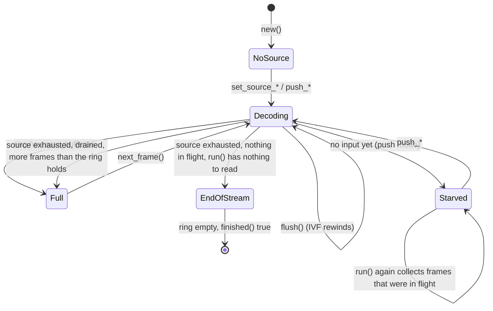

# Decoder core

> **Status:** PARTIAL — bit-exact and well tested; a truncated IVF frame turns `run()` into an endless error.
> **Owners (code):** `src/decoder.rs`, `src/core.rs`, `src/wasm.rs`, `src/lib.rs`
> **Related docs:** [input-sources.md](./input-sources.md), [frames-and-rendering.md](./frames-and-rendering.md), [variants-and-threading.md](./variants-and-threading.md), [`../rivet-av1.md`](../rivet-av1.md), [`../performance.md`](../performance.md)
> **Last verified against code:** 2026-11-13 @ the commit after `4aa6d72` (frames in flight)

## Overview

`Decoder` wraps the AV1 decoder and a ring of decoded frames, driven the way
upstream wasm-av1 drove libaom: the caller asks for a bounded step of work
(`run`), pops frames (`next_frame`), and asks whether it is done (`finished`).
That pull shape suits a `requestAnimationFrame` loop on a main thread and a
pump loop in a Worker alike. The same Rust type is used natively (tests,
`examples/decode_ivf.rs`) and in wasm through `Av1Decoder`
(`src/wasm.rs:89-536`).

The decoder underneath is **rivet-av1**, rivet's own AV1 decoder, and since
0.3.0 the only one: rav1d, the core of 0.1.0 to 0.2.2, was removed. It sits
behind a handful of calls (`open`, `flush`, `send`, `picture`, `finish`) in
the private `core` module (`src/core.rs`), which with the thread pool in
`src/threads.rs` is all of the crate that names it.

**Speed.** As first built on 2026-11-12 it was slower than rav1d was: a
third to two thirds of its rate on one thread in wasm, and 1.2 to 1.3
times from eight threads on a stream with one tile per frame. As measured
on 2026-11-13, after the work in rivet-av1, one thread is level with or
ahead of rav1d on 8-bit 720p and 1080p video (1.12 to 1.21 times in the
SIMD variant, 1.00 to 1.07 in the baseline one; 0.87 and 0.94 on a
synthetic test pattern), and a one-tile stream gains 3.7 to 4.2 times from
eight threads, 1.3 times rav1d's rate there. A stream with several tiles
per frame gains about twice from threads and is behind rav1d on eight.
[`../rivet-av1.md`](../rivet-av1.md) has every number, with rav1d as the
baseline.

**With more than one thread, output lags input.** The core then decodes
several frames at once, so a unit's frames reach the ring a few units
after it was taken, and the end of the input has a drain. With one thread
there is no delay. The sections below say where that shows.

## How it works today

### Data model

`Decoder` (`src/decoder.rs:202-235`) holds:

- `inner`: the core (`src/core.rs:39-47`): an `av1::Decoder`, `pts` (the
  pts of the units queued in it, oldest first), `ready` (frames decoded
  that `Decoder` has not pulled yet) and `dropped` (units that failed while
  their frames were being collected, not yet counted). With one thread
  rivet-av1 decodes a unit when it is queued, so nothing is ever in
  flight. With more, `new_decoder` (`src/core.rs:49-59`) turns on
  rivet-av1's frames in flight: as many frames as threads, at most 8
  (`MAX_FRAMES_IN_FLIGHT`), and at most 8 × 1920 × 1088 luma samples
  between them (`MAX_SAMPLES_IN_FLIGHT`: eight 1080p frames, two at 4K,
  about 330 MB at the most).
- `source`: `Ivf`, `Container` or `Push` (`src/decoder.rs:154-167`); see
  [input-sources.md](./input-sources.md).
- `ring: VecDeque<Frame>`, capped at `Config::max_buffered` (default 10,
  upstream's `NUM_FRAMES_BUFFERED`, `src/decoder.rs:41`), and `current`, the
  frame last popped, which stays readable until the next pop.
- `Stats` (`src/decoder.rs:142-147`): temporal units in, bytes in, frames out,
  decode errors. Never reset, including by `flush`.

### Interfaces

| Kind | Name | Notes |
|---|---|---|
| Rust | `Decoder::new(Config)` | `Config { max_buffered, apply_grain, threads }` (`src/decoder.rs:44-73`). Returns `Result`, and cannot fail with this core (`247-268`) |
| Rust | `run() -> RunOutcome` | `Full`, `Consumed`, `Starved`, `EndOfStream` (`src/decoder.rs:128-138`) |
| Rust | `run_until_full()` | `run` until anything but `Consumed` (`src/decoder.rs:723-730`) |
| Rust | `next_frame`, `peek_next`, `current_frame`, `take_current_frame` | `src/decoder.rs:701-720` |
| Rust | `finished()` | `src/decoder.rs:582-584` |
| Rust | `units_in_flight()` | Units the core has taken whose frames have not come out; always 0 with one thread (`src/decoder.rs:566-568`) |
| Rust | `flush()` | `src/decoder.rs:523-536` |
| wasm | `new Av1Decoder(maxBuffered?, applyGrain?, threads?)` | `src/wasm.rs:105-122`; `threads()` reports what applied |
| wasm | `run`, `runUntilFull`, `framesBuffered`, `unitsInFlight`, `finished`, `stats`, `flush` | `src/wasm.rs:274-322`; `RunResult` is the enum as 0-3 (`src/wasm.rs:53-60`) |
| wasm | `width`, `height`, `timeBaseNum/Den`, `frameCountHint`, `frameRateHint`, `durationHint` | `src/wasm.rs:327-385` |
| wasm | `simdEnabled`, `threadsSupported`, `containerSupport`, `version` | free functions, `src/wasm.rs:25-50` |

`Config::apply_grain` (default true) is rivet-av1's
`Decoder::set_apply_grain`: off, a frame comes out as decoded, without the
film grain its stream asks for (`src/core.rs:49-59`). `Config::threads` is
the number of threads the core decodes with: the rows of a one-tile frame
behind its parsing, the tiles of a frame of several, and, above one
thread, several frames at once. On wasm it is forced to 1 unless the build
has atomics (`effective_threads`, `src/decoder.rs:238-244`; see
[variants-and-threading.md](./variants-and-threading.md)).

Errors (`src/decoder.rs:76-116`): `Ivf`, `NotAv1`, `Container`, `Open`,
`Decode` (the temporal unit is dropped, the decoder stays usable), `NoSource`,
`WrongMode`. `Decode` carries the core's own error, exported as
`wasm_av1::CoreError`: `av1::Error`, which is `Bitstream`, `Unsupported` or
`InvalidInput` with a message (`src/core.rs:18`). `Open` is never returned
today: nothing in rivet-av1 can fail when a decoder is created. In wasm
every error becomes a thrown `JsError` with the `Display` text, which for a
decode error begins `rivet-av1: `.

### Flow

`run()` (`src/decoder.rs:618-680`), in order:

1. No source: `NoSource`. Ring full: `Full`, nothing read.
2. Frames the core has ready go into the ring first (those that did not
   fit last time, and those that were in flight and have been decoded
   since); if that fills it, `Full`.
3. Take the next temporal unit from the source. None available and the
   source not exhausted: `Starved`. None available and the source
   exhausted: the core's `finish` (`src/core.rs:131-139`) decodes every
   unit still in flight, counting those that fail in `decode_errors`, and
   their frames are collected; `Full` if they did not all fit into the
   ring, else `EndOfStream`.
4. Otherwise `send(data, pts)` (`src/core.rs:92-105`): the core puts a
   temporal delimiter in front, queues the unit in rivet-av1 and takes the
   frames of whatever units are decoded, each with the pts its unit came
   with. With one thread that is this unit. With more it is usually an
   earlier one, and an error `send` returns is that of the oldest unit not
   yet reported. Then `collect_pictures` (`src/decoder.rs:684-695`) moves
   frames into the ring as far as it has room, and `run` returns
   `Consumed`. A `Decode` error counts in `decode_errors` and propagates;
   a unit that fails while `collect_pictures` is pulling frames is counted
   there (`take_dropped`) and raises nothing.

`finished()` is stricter than upstream's: source exhausted, nothing in
flight in the core **and** every decoded frame popped, so a player does
not stop with frames still buffered (`src/decoder.rs:25-28`, `582-584`).
With one thread it is true as soon as the last frame is popped. With more
it needs the `run()` of step 3 first, which drains what is in flight (as
rav1d's frame threads did in 0.2.x).

`units_in_flight()` is what a caller polls on in between: after a
`Starved`, while it is not 0, a later `run()` collects frames with no new
input. The decode Worker does that every 4 ms (`repoll` in
`js/worker.js`).

`flush()` calls `reset_state` (`src/decoder.rs:542-553`: the core's `flush`,
ring cleared, and the sequence-header flag re-armed for CMAF) and then: IVF
rewinds, a container source is **dropped** (rivet is forward-only), push mode
clears its queue. The core's `flush` is rivet-av1's `Decoder::reset`
(`src/core.rs:80-85`): the stream is forgotten with everything queued or
in flight, the settings stay, and the threads belong to a pool that
outlives the decoder, so a seek does not respawn Workers.

### Configuration

Cargo features (`Cargo.toml:42-45`): `container` (rivet's demuxers), on by
default, and nothing else. The decoder is not optional and has no build
options: the `bitdepth_8` / `bitdepth_16` features of 0.2.x selected rav1d's
sample depths and went with it; rivet-av1 decodes every depth with one code
path. The release profile is fat LTO, one codegen unit, `panic = "abort"`
(`Cargo.toml:47-53`), so a panic in wasm is a trap, not an exception.

### Edge cases & gotchas

- **A truncated IVF frame never clears.** `IvfReader::next_frame` returns
  `TruncatedFrame` without moving its cursor (`src/ivf.rs:176-196`), and
  `is_empty` is false while 12 bytes remain (`src/ivf.rs:160-162`). Every
  later `run()` fails the same way; `finished()` stays false. The callers in
  `js/` retry on error, so this becomes a busy loop. Fix: mark the reader
  exhausted on a framing error, or skip to the end.
- `Stats` survive `flush()`; consumers that compare them with their own
  counters after a seek (see `js/hls.js`) drift.
- `pushTemporalUnit`'s `pts` crosses the wasm boundary as `f64` and is cast to
  `i64` (`src/wasm.rs:205-208`); `NaN` becomes 0.
- **A damaged frame is not concealed.** rivet-av1 returns an error and
  decoding resumes cleanly at the next keyframe (rav1d carried on with what
  it had). The temporal unit counts in `decode_errors`, the frames it
  showed before the error are lost with it, and the decoder stays usable
  (`tests/decode.rs`, `a_unit_that_lost_its_tiles_costs_no_more_than_its_gop`).
- `src/core.rs:92-105` puts a temporal delimiter in front of every unit it
  hands rivet-av1. MP4 and Matroska samples come without one, and
  rivet-av1 only forgets an unfinished frame when it sees one: measured on
  an SVT-AV1 stream, a single unit cut after its frame header made every
  later unit fail with "OBU_FRAME while a frame is in progress".
- **Frames come out with no delay on one thread only.** There, the frames
  a unit shows are in the ring (or waiting for room in it) when its `run()`
  returns. With more than one thread they arrive a few units later, or at
  the end of the input, always in the order the units went in. A caller
  that feeds a unit and expects its frame from the same `run()` (a
  single-frame preview, a step-by-step tool) should use one thread, or
  poll `units_in_flight()`.
- **With threads, an error is late too.** `run()` reports a damaged unit
  when that unit's turn comes, which is a few calls after the one that
  took it, or only in `decode_errors` if it surfaced while frames were
  being collected.

## History & references

- [`../rivet-av1.md`](../rivet-av1.md): what rivet-av1 is, how it is wired
  in, what it replaced and what was measured.
- 0.3.0, 2026-11-12: rav1d removed. `src/core_rav1d.rs` deleted and
  `src/core_rivet.rs` became `src/core.rs`; the `input_pending` /
  `needs_drain` states and `drain_in_flight`, which existed for rav1d's
  `TryAgain` and frame delay, went from `decoder.rs`; `Frame::from_picture`
  went with `rav1d::Picture`.
- Upstream: GoogleChromeLabs/wasm-av1 `decode-av1.c` (`AVX_Decoder_*`).
- 2026-11-13: frames in flight. With rivet-av1 `03054ad`, `src/core.rs`
  queues units (`queue`, `poll`, `wait`) where it called `decode_all`, the
  end-of-input drain came back as `Core::finish`, `flush` became
  `Decoder::reset`, and `units_in_flight` was added.
- `tests/decode.rs`: every fixture matches the libdav1d/libaom MD5 on 1, 2
  and 4 threads; film grain on and off; flush at every point; push mode
  equals IVF mode.

## Proposed / Ideas (backlog)

| Idea | Motivation | Sketch | Status |
|---|---|---|---|
| Exhaust the IVF reader on a framing error | Ends the error loop | Set `pos = data.len()` before returning `TruncatedFrame`/`FrameTooLarge`; test with a cut fixture | Proposed |
| Reset `Stats` on source change | Comparable counters after a seek | Zero in `reset_state`, or expose a `since_reset` copy | Proposed |
