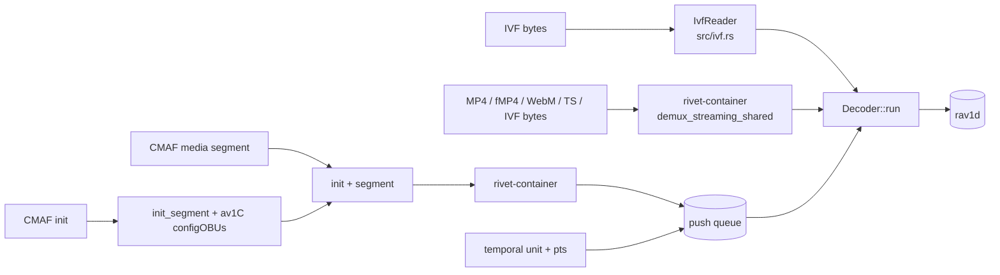
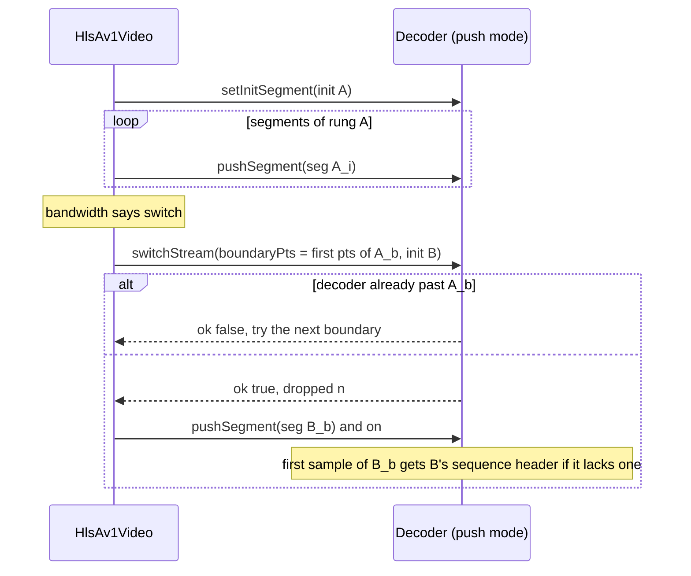

# Input sources

> **Status:** STABLE
> **Owners (code):** `src/decoder.rs`, `src/ivf.rs`, `src/wasm.rs` (input section), `js/decoder.js` (`sniff`, `switchStream`)
> **Related docs:** [decoder-core.md](./decoder-core.md), [player-and-hls.md](./player-and-hls.md), [`../rivet.md`](../rivet.md), [`../integration.md`](../integration.md)
> **Last verified against code:** 2026-11-06 @ `07e0968`

## Overview

The decoder accepts AV1 four ways: a whole IVF file, a whole container file
demuxed by rivet inside the wasm, CMAF segments pushed one at a time against
an init segment, or raw temporal units pushed by a caller that demuxed them
itself. Only one source is active; switching mode resets the decoder, except
that the two push forms share one queue.

## How it works today

### Interfaces

| wasm (`Av1Decoder`) | Rust (`Decoder`) | Mode | Notes |
|---|---|---|---|
| `setSourceIvf(bytes)` | `set_source_ivf` (`src/decoder.rs:298-309`) | IVF | Copies the file in; rejects a fourcc other than `AV01` |
| `setSourceContainer(bytes)` | `set_source_container` (`src/decoder.rs:323-341`) | Container | MP4/MOV, fMP4/CMAF, WebM/MKV, MPEG-TS, and since rivet `2100c31` IVF too; rejects a non-AV1 video track |
| `setInitSegment(init)` | `set_init_segment` (`src/decoder.rs:350-363`) | Push | Keeps `ftyp`+`moov`, extracts the `av1C` configOBUs |
| `pushSegment(seg)` | `push_segment` (`src/decoder.rs:371-430`) | Push | Demuxes `init ‖ segment`, queues every sample; returns the count |
| `pushTemporalUnit(obus, pts)` | `push_temporal_unit` (`src/decoder.rs:471-484`) | Push | One sample's OBUs |
| `endOfStream()` | `end_of_stream` (`src/decoder.rs:488-492`) | Push | Lets `finished` become true |
| `truncateQueuedFrom(pts)` | `truncate_queued_from` (`src/decoder.rs:526-536`) | Push | Drops queued, undecoded units with `pts >= pts` |
| `pendingInput`, `nextQueuedPts`, `lastSentPts`, `lastSegmentFirstPts/LastPts` | `src/decoder.rs:495-514`, `436-438` | Push | What a rendition switch needs to pick a safe boundary |

JS: `Decoder.setSource(bytes)` sniffs the magic bytes (`js/decoder.js:132-140`)
and sends IVF to `setSourceIvf`, everything else to `setSourceContainer`
(`js/decoder.js:187-189`).

### Flow

**IVF.** `IvfReader` (`src/ivf.rs:127-200`) parses the 32-byte header
(denominator-first time base, exposed so that `seconds = pts * num / den`,
`src/ivf.rs:33-37`) and walks 12-byte frame headers over the owned buffer.
Frames over 256 MiB are treated as corruption (`src/ivf.rs:47`). `flush`
rewinds.

**Container.** rivet's streaming demuxer is boxed in the source; each `run()`
asks it for `next_video_sample()` (`src/decoder.rs:676-689`). A damaged sample
is reported as an error and counted, and the demuxer is assumed to continue.
Time base is `(1, timescale)`. Containers are forward-only: `flush` drops the
source and the caller must set it again.

**CMAF segments.** `push_segment` prepends the remembered init segment and
demuxes the pair as one file, so the decoder is never reset between segments.
After an init segment (or a flush), the first sample pushed gets the `av1C`
configOBUs prepended unless it already carries a sequence header
(`src/decoder.rs:406-417`, helpers `av1c_config_obus` at `822` and
`tu_has_sequence_header` at `844`). That is what makes a rendition switch
decode without a flush when the encoder does not repeat the sequence header
in every keyframe.

**Seamless rendition switch.** `Decoder.switchStream({boundaryPts, init})`
(`js/decoder.js:254-264`) checks the decoder has not reached the boundary
(`nextQueuedPts` / `lastSentPts`), truncates the queue at it, and installs the
new init segment; segments of the other rung from that boundary follow.
Nothing decoded is lost and nothing is flushed.

### Edge cases & gotchas

- `setInitSegment` and `pushSegment` switch to push mode **keeping** queued and
  decoded frames if already in push mode; from IVF/container mode they reset.
- `pushSegment` that fails half way leaves the samples before the error
  queued, and does not update `lastSegment*Pts` (`src/decoder.rs:421-428`).
- The `av1C` lookup scans for the fourcc rather than walking boxes
  (`src/decoder.rs:823-825`); fine for an init segment, not general.
- Without the `container` feature, the container and segment entry points
  throw and IVF / raw temporal units still work (`src/wasm.rs:146-201`).
- An IVF handed to `setSourceContainer` was refused before rivet `2100c31`
  and decodes now (`tests/container.rs:100`), but the committed `pkg/` was
  built before that change; see [build-and-release.md](./build-and-release.md).

## History & references

- [`../rivet.md`](../rivet.md): which rivet commit lets `rivet-container`
  build without `rivet-codec`, and what it demuxes.
- `07e0968`: rivet to `2100c31`, IVF as a container.
- `tests/container.rs`: MP4/fMP4/WebM equal the IVF MD5; CMAF segments one by
  one, single and threaded; rendition switch is seamless, single and threaded.

## Proposed / Ideas (backlog)

| Idea | Motivation | Sketch | Status |
|---|---|---|---|
| Walk boxes for `av1C` | Robust against a stray fourcc in metadata | Parse `moov/trak/mdia/minf/stbl/stsd/av01/av1C` | Proposed |
| Byte-range segments | HLS `EXT-X-BYTERANGE` ladders | Range fetches in `hls.js`; the decoder side needs nothing | Proposed |
