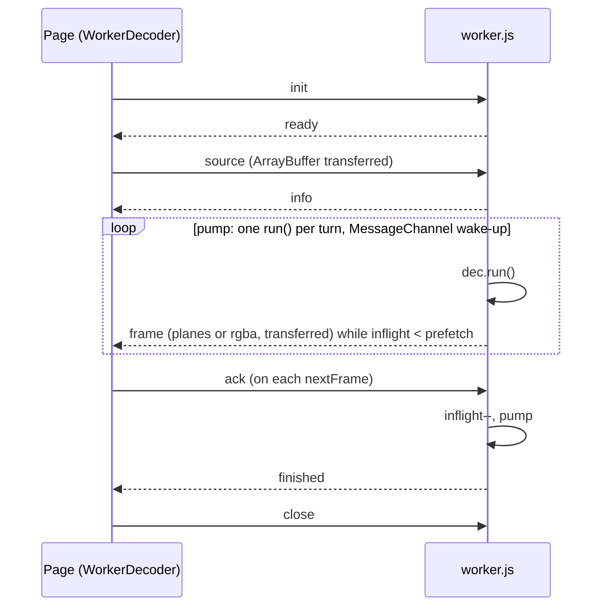

# JS decoder API and the decode Worker

> **Status:** PARTIAL — works and is covered by the browser matrix; flush/reload races and one hang are open.
> **Owners (code):** `js/index.js`, `js/decoder.js`, `js/worker.js`, `js/worker-client.js`
> **Related docs:** [decoder-core.md](./decoder-core.md), [frames-and-rendering.md](./frames-and-rendering.md), [variants-and-threading.md](./variants-and-threading.md), [player-and-hls.md](./player-and-hls.md)
> **Last verified against code:** 2026-11-06 @ `07e0968`

## Overview

`Decoder` (`js/decoder.js:145-357`) is a thin JS shape over the wasm
`Av1Decoder`: typed views instead of pointers, `null` instead of `NaN`, a
`timeBase` in seconds per tick, and generation checks on frames.
`WorkerDecoder` (`js/worker-client.js:7-235`) offers the same feed/pull shape
from the page while `js/worker.js` owns a `Decoder` in a Worker and posts
frames as transferable buffers. Everything is exported from `js/index.js:14-20`.

## How it works today

### Interfaces

`Decoder` (in-thread): `setSourceIvf`, `setSourceContainer`, `setSource`,
`pushTemporalUnit`, `setInitSegment`, `pushSegment`, `lastSegmentRange`,
`nextQueuedPts`, `lastSentPts`, `truncateQueuedFrom`, `switchStream`,
`setTimeBase`, `endOfStream`, `flush`, `run`, `runUntilFull`,
`framesBuffered`, `unitsInFlight`, `finished`, `pendingInput`, `info()`, `stats()`,
`secondsOf`, `peekPts`, `peekSeconds`, `nextFrame`, `currentFrame`, `free`.
`Run` mirrors the wasm `RunResult` (`js/decoder.js:143`).

Worker protocol (`js/worker.js:10-11`):

| Direction | Message | Handler | Notes |
|---|---|---|---|
| in | `init {variant, baseUrl, output, prefetch, maxBuffered, applyGrain, threads}` | `js/worker.js:81-89` | Answers `ready {variant, simd, threads, version}` |
| in | `ivf` / `container` / `source {data}` | `90-101` | Resets `inflight`, answers `info` |
| in | `push {data, pts, timeBase}` | `102-107` | |
| in | `initSegment {data}` | `108-110` | No reply |
| in | `segment {data, tag}` | `111-123` | Answers `segment {tag, samples, error, firstPts, lastPts, timeBase, info}` |
| in | `switchStream {boundaryPts, init, tag}` | `124-135` | Answers `switched {tag, ok, dropped}` |
| in | `eos`, `flush`, `ack {count}`, `close` | `136-155` | `flush` answers `flushed` |
| out | `frame {frame, stats}` | `pump`, `41-75` | `frame` is `Frame.toTransferable()`; `data` (and `rgba`) transferred |
| out | `finished`, `error {message, fatal}`, `spawnThread` | | `fatal` only for a failed `init` |

`WorkerDecoder` turns `segment` and `switchStream` into promises keyed by
`tag` (`js/worker-client.js:116-130`), queues frames, and acks each one taken
with `nextFrame()`; `frame()` awaits the next one or `null` at the end.

### Flow

The pump (`js/worker.js:41-75`) does one `run()` per turn, ships frames while
fewer than `prefetch` (default 6) are unacknowledged, and reschedules itself
through a `MessageChannel` so incoming messages interleave. Output is
`'planes'` for WebGL or `'rgba'` for a 2D canvas (converted in the Worker).
One copy per frame out of wasm memory is unavoidable: wasm memory cannot be
transferred.

### Edge cases & gotchas

- **Stale frames after `flush()` or a new source.** The page clears its queue
  (`js/worker-client.js:132-138`, `194-198`), but `frame` messages already in
  flight from the Worker arrive afterwards and are queued, and their acks then
  undercount. No generation travels with the messages. Expect a few frames of
  the old position after a seek or a reload.
- **`Av1Player.load()` can hang in Worker mode.** It polls `src.info`
  every 5 ms (`js/player.js:129-133`); a source the Worker rejects produces an
  `error`, not an `info`, so the promise never settles.
- **Errors in `run()` are retried.** The pump treats a throw as `CONSUMED`
  and reschedules (`js/worker.js:50-55`); with a truncated IVF this repeats
  forever ([decoder-core.md](./decoder-core.md)).
- `finished` is posted again on every `ack` after the end.
- With threads the decoder hands frames back a few units after their data
  went in, decoding them on the pool while the decode Worker is idle. Nothing
  wakes the Worker when they are done, so when `run()` has no input left and
  `unitsInFlight` is not 0 it looks again every 4 ms (`repoll` in
  `js/worker.js`). Without that a live stream that never sends `eos` lost
  its last frames in Firefox and WebKit; `test/browser.mjs` has the case.
  A caller driving `Decoder` itself has to do the same: `Run.STARVED` with
  `unitsInFlight > 0` means frames are still coming.
- If the Worker dies, outstanding `_request` promises never resolve.
- Bundlers only recognise the Worker if the URL is built inline in `new
  Worker(new URL(...))`; serving `js/` statically and passing `workerUrl` is
  the predictable route (`js/worker-client.js:32-39`).

## History & references

- Upstream listed "offloading the decoding into a web worker" as future work;
  `js/worker.js` is that.
- `test/browser.mjs`: Chromium, Firefox, WebKit, main thread and Worker.

## Proposed / Ideas (backlog)

| Idea | Motivation | Sketch | Status |
|---|---|---|---|
| Generation on source/flush | Drop stale frames | Page sends `gen`; Worker stamps frames; client ignores old ones | Proposed |
| `info` or `error` as a reply | `load()` cannot hang | Make `source` a tagged `_request` that rejects on error | Proposed |
| Back off on repeated errors | No hot loop | Stop scheduling after N consecutive errors with no progress | Proposed |
