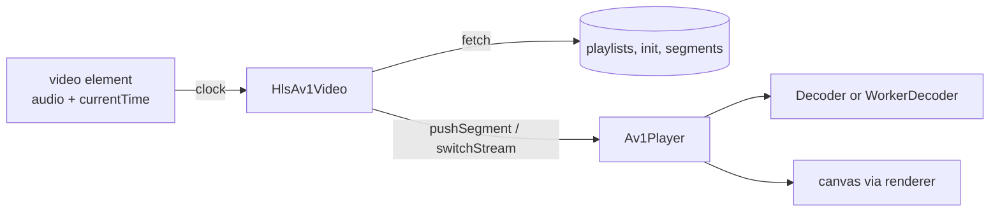

# Av1Player and HlsAv1Video

> **Status:** STABLE
> **Owners (code):** `js/player.js`, `js/hls.js`, `demo/index.html`
> **Related docs:** [js-api-and-worker.md](./js-api-and-worker.md), [input-sources.md](./input-sources.md), [frames-and-rendering.md](./frames-and-rendering.md), [`../integration.md`](../integration.md)
> **Last verified against code:** 2026-11-06 @ `07e0968`

## Overview

`Av1Player` (`js/player.js:26-302`) is a deliberately small canvas player: a
`requestAnimationFrame` loop that shows frames at `pts × timeBase`, drops late
ones, decodes within a per-tick budget, and measures stutter. It is a
reference for an integration, not a full player: no audio, no seek UI.
`HlsAv1Video` (`js/hls.js:181-452`) builds on it for the case lewd's player
has: keep the `<video>` for the audio rendition and the clock, paint the AV1
video rendition on a `<canvas>` from HLS/CMAF segments.

## How it works today

### Interfaces

| Class | Members | Notes |
|---|---|---|
| `Av1Player(canvas, opts)` | `init`, `load(bytes)`, `openStream({timeBase})`, `pushTemporalUnit`, `endOfStream`, `play`, `pause`, `stop`, `destroy`, `stats`, `onstate/onstats/onerror` | Options: `renderer`, `worker`, `workerUrl`, `variant`, `threads` (number or `'auto'`), `baseUrl`, `maxBuffered`, `applyGrain`, `decodeBudgetMs` (8), `fallbackFps` (24), `clock` (`js/player.js:27-46`) |
| `HlsAv1Video(canvas, opts)` | `loadMaster`, `selectVariant(v, {at})`, `variantForBandwidth`, `start`, `stop`, `seek`, `destroy`, `stats`, `onvariant/onerror` | Adds `clock` (required), `fetchBytes`, `fetchText`, `prefetchSeconds` (8), `maxBuffered` (16), `bandwidthEstimate` (`js/hls.js:182-192`) |
| Helpers | `parseMaster`, `parseMediaPlaylist`, `isAv1Codecs`, `BandwidthEstimator`, `resolveThreads` | `js/hls.js:44-170`, `js/player.js:17-24` |

`stats` (`js/player.js:61-76`, plus `js/hls.js:228-237`): frames shown,
dropped and late, stalls and stall time, decode and draw ms, fps, buffered,
variant, simd, threads, renderer, draw path, decoder counters, bandwidth,
buffer ahead, slow fetches, rung in effect.

### Flow: the player loop

`_loop` (`js/player.js:208-301`): read the clock (external, or free-running
from `play()`); pop frames whose due time has passed, dropping each one whose
successor is also due; account lateness and stalls; draw; then
`_decodeSome` runs the in-thread decoder until the ring is full, input runs
out or `decodeBudgetMs` is spent (the Worker decodes on its own). It ends
when the source reports `finished` with nothing buffered.

### Flow: HLS

1. `loadMaster` parses `EXT-X-STREAM-INF` variants (CODECS, RESOLUTION,
   BANDWIDTH, AUDIO) and `EXT-X-MEDIA` audio renditions.
2. `selectVariant` fetches the media playlist and its `EXT-X-MAP` init
   segment, opens the player in push mode and starts `_pump`.
3. `_pump` (`js/hls.js:413-451`) keeps segments pushed `prefetchSeconds`
   ahead of the clock, every 250 ms and after each event, feeding the
   bandwidth estimator (two EWMAs, the lower wins) and counting slow fetches.
4. A later `selectVariant` with `at: 'boundary'` (`js/hls.js:314-366`) finds
   the next segment boundary the decoder has not reached in segment-aligned
   playlists and calls `switchStream`, up to three attempts, then falls back
   to a hard switch (`flush` and refill, a visible gap).
5. `seek(seconds)` bumps the generation, flushes, and restarts pushing from
   the segment holding `seconds`.

A generation counter drops results of fetches that a switch or seek
superseded.

### Edge cases & gotchas

- Playlist support is what CMAF VOD ladders use: no byte ranges, no live or
  LL-HLS, no encryption (`js/hls.js:18-21`).
- A segment fetch or push that fails is reported through `onerror` and
  retried on the next pump tick, indefinitely.
- **Boundary choice drifts late.** `_switchAtBoundary` finds the decoding
  segment by summing pushed samples until they exceed
  `stats.decoder.temporalUnitsIn` (`js/hls.js:332-338`). That counter is never
  reset by a flush and `_pushed` is capped at 64 entries (`js/hls.js:438`), so
  after a seek or a long playback the sum never exceeds it and the boundary
  chosen is the first segment not yet pushed. The switch still works; it
  takes effect up to `prefetchSeconds` later than it could.
- Choosing a rung is the caller's job: `variantForBandwidth` gives the network
  side; [`../integration.md`](../integration.md) describes combining it with
  stutter stats.

## History & references

- [`../integration.md`](../integration.md): the decision to fall back, the
  video-plus-canvas shape, rung selection, isolation headers, serving.
- `527e95a` (0.2.2): seamless rung switches, stutter and bandwidth
  measurement.
- `demo/index.html` (`npm run serve`, then `/demo/`): the file paths.

## Proposed / Ideas (backlog)

| Idea | Motivation | Sketch | Status |
|---|---|---|---|
| Count decoded units per source | Boundary switches as early as possible after a seek | Compare with samples decoded since the last reset, not lifetime `temporalUnitsIn` | Proposed |
| Retry back-off | Fewer requests to a failing origin | Exponential delay on repeated segment errors | Proposed |
