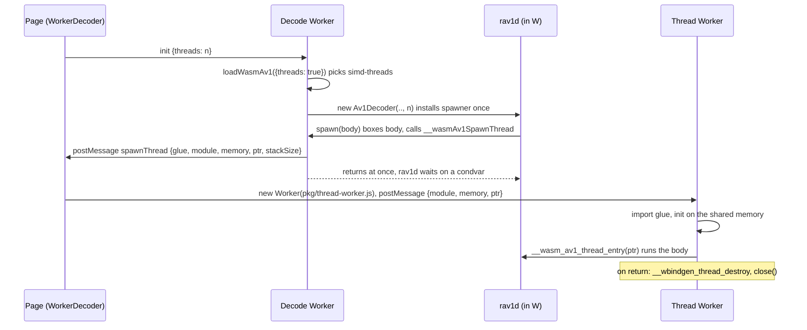

# wasm variants, detection and threading

> **Status:** PARTIAL — the four variants work and are tested in three engines; rav1d's thread Workers are never torn down.
> **Owners (code):** `js/detect.js`, `js/loader.js`, `src/threads.rs`, `js/thread-worker.js`, `scripts/build.sh`, `Cargo.toml`
> **Related docs:** [js-api-and-worker.md](./js-api-and-worker.md), [build-and-release.md](./build-and-release.md), [`../rav1d.md`](../rav1d.md), [`../performance.md`](../performance.md), [`../integration.md`](../integration.md)
> **Last verified against code:** 2026-11-06 @ `07e0968`

## Overview

There are four builds of the same crate under `pkg/`, and the loader picks one
at run time. WebAssembly has no feature query, so detection validates tiny
modules that use exactly the instruction in question. The threads builds run
rav1d's frame and tile worker threads as Web Workers sharing one
`WebAssembly.Memory`. That needs a cross-origin-isolated page (COOP + COEP)
and the decoder itself in a Worker, because rav1d blocks its calling thread
on `memory.atomic.wait`.

| Variant | Rust flags (`scripts/build.sh:92-99`) | Engines |
|---|---|---|
| `baseline` | rustc's default wasm32 features | Chrome 96, Firefox 89, Safari 15 |
| `simd` | `+simd128` | Chrome 91, Firefox 89, Safari 16.4 |
| `threads` | `+atomics,+bulk-memory,+mutable-globals`, shared imported memory (max 1 GiB), `-Zbuild-std` | + cross-origin isolation (Safari 15.2) |
| `simd-threads` | both | + cross-origin isolation |

## How it works today

### Interfaces

| Kind | Name | Notes |
|---|---|---|
| JS | `detectSimd()`, `detectBaseline()`, `detectThreads()` | `js/detect.js:13-81`; `detectThreads` also requires `SharedArrayBuffer`, `crossOriginIsolated` and `Worker` |
| JS | `chooseVariant({threads})` | SIMD first, then baseline; threaded only if asked and possible; `null` if nothing runs (`js/detect.js:91-96`) |
| JS | `loadWasmAv1({variant, threads, baseUrl, fetch})` | Imports `pkg/<variant>/wasm_av1.js` by URL; one cached runtime per `variant@baseUrl` (`js/loader.js:85-126`) |
| JS | `spawnThreadWorker(msg)`, `THREAD_STACK_SIZE` (2 MiB) | `js/loader.js:30`, `59-64` |
| Global | `globalThis.__wasmAv1SpawnThread(module, memory, ptr)` | Installed by the loader in whichever context instantiated a threads build (`js/loader.js:35-51`) |
| wasm export | `__wasm_av1_thread_entry(ptr)` | Runs one thread body (`src/threads.rs:63-69`) |

### Flow: a thread starting

The request goes up to the page rather than the decode Worker creating its
own child, because the decode Worker is about to block waiting for that
thread and Chromium only starts a nested Worker once its parent returns to
the event loop (deadlock), and Safari before 16.4 has no nested Workers
(`js/loader.js:10-20`). On a page that instantiates a threads build directly
the loader spawns the Worker itself (`js/loader.js:45-46`).

rav1d's side is the fork's embedder spawner
(`rav1d::wasm_thread::set_thread_spawner`, registered once by
`src/threads.rs:54-59`); `parking_lot_core`'s `nightly` feature supplies the
real wasm parker (`Cargo.toml:34-39`). Thread count: `Av1Player` resolves
`threads: 'auto'` to `hardwareConcurrency` capped at 8
(`js/player.js:17-24`); rav1d picks its frame-thread count from that.

### Configuration

- Serve `pkg/` as static files; pass `baseUrl` if it is not next to `js/`
  (`js/loader.js:102`).
- The page must send `Cross-Origin-Opener-Policy: same-origin` and
  `Cross-Origin-Embedder-Policy: require-corp` for any threads variant
  ([`../integration.md`](../integration.md) covers serving).
- `opts.fetch` lets a caller add credentials to the `.wasm` request.

### Edge cases & gotchas

- **Thread Workers are never torn down.** `spawnThreadWorker` returns the
  Worker but nothing keeps it. `WorkerDecoder.close()` posts `close` and calls
  `terminate()` immediately after (`js/worker-client.js:231-234`), so the
  decode Worker probably dies before it runs `dec.free()`. The thread Workers,
  created by the page, then sit blocked on the shared memory. Not reproduced;
  a page that creates and destroys threaded players would accumulate Workers
  and their 2 MiB stacks plus the shared heap.
- A thread Worker that fails to import or traps logs to the console and the
  decoder waits forever (`js/thread-worker.js:18-31`). Nothing surfaces it as
  an `error` message.
- A threads runtime instantiated on the main thread can only use 1 thread:
  rav1d would block the main thread. `Av1Player` without `worker: true` never
  asks for a threads build (`js/player.js:100`).
- The loader caches runtimes forever (`js/loader.js:24`); every decoder in a
  context shares one wasm instance and one memory, which grows and never
  shrinks.

## History & references

- [`../rav1d.md`](../rav1d.md): the fork's `e051d04` (embedder-spawned
  threads, condvar handshake) and `55c4d09` (SIMD128 kernels).
- [`../performance.md`](../performance.md): 1080p from 16 ms to 3 ms a frame
  on 8 threads in Chromium, bit-exact.

## Proposed / Ideas (backlog)

| Idea | Motivation | Sketch | Status |
|---|---|---|---|
| Track and terminate thread Workers | No leak on `destroy()` | `WorkerDecoder` keeps the Workers it spawned and terminates them in `close()`; wait for a `closed` reply before terminating the decode Worker | Proposed |
| Report a dead thread | A hang becomes an error | `thread-worker.js` posts to the page; `WorkerDecoder` raises `onerror` | Proposed |
