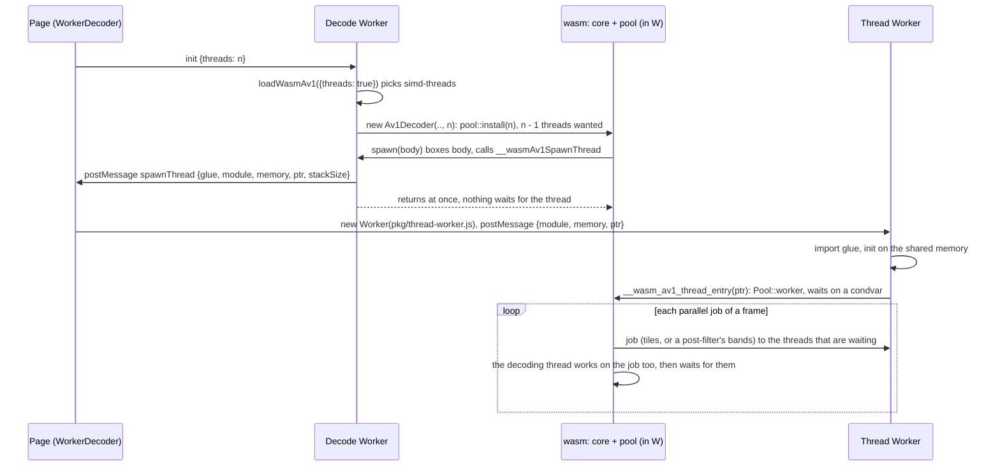

# wasm variants, detection and threading

> **Status:** PARTIAL — the four variants work, and decode on real threads in the threads builds, in Chromium, Firefox and WebKit; threads buy little on a one-tile stream.
> **Owners (code):** `js/detect.js`, `js/loader.js`, `src/threads.rs`, `js/thread-worker.js`, `scripts/build.sh`, `tools/wasm-copy-guard`, `Cargo.toml`
> **Related docs:** [js-api-and-worker.md](./js-api-and-worker.md), [build-and-release.md](./build-and-release.md), [`../rivet-av1.md`](../rivet-av1.md), [`../performance.md`](../performance.md), [`../integration.md`](../integration.md)
> **Last verified against code:** 2026-11-12 @ `162385f`

## Overview

There are four builds of the same crate under `pkg/`, and the loader picks one
at run time. WebAssembly has no feature query, so detection validates tiny
modules that use exactly the instruction in question. The threads builds run
the decoder's parallel work — the tiles of a frame, and the loop filter,
CDEF and loop restoration in bands — on a pool of Web Workers sharing one
`WebAssembly.Memory`. That needs a cross-origin-isolated page (COOP + COEP)
and the decoder itself in a Worker, because the decoding thread blocks on
`memory.atomic.wait` while the others work.

**What the variants buy, honestly.** Measured on 2026-11-12 with rivet-av1
(Node / V8, one Apple silicon machine): the SIMD variant is 1.3 to 2.1
times the baseline one. Threads are another matter: on eight threads a
stream with one tile per frame, which is what most encoders produce below
4K, decodes 1.2 to 1.3 times as fast as on one, because only the
post-filters are left to share out; a stream encoded with eight tiles
reaches 3.3 to 3.6 times. rav1d, which 0.2.x used and which threaded whole
frames, reached 2.8 to 3.6 times on the one-tile streams and 6.3 on the
eight-tile one, from a single-thread rate two to three times higher. Frame
threading is part of the performance work under way in rivet-av1;
[`../rivet-av1.md`](../rivet-av1.md) has the tables.

| Variant | Rust flags (`scripts/build.sh:100-107`) | Engines |
|---|---|---|
| `baseline` | rustc's default wasm32 features | Chrome 96, Firefox 89, Safari 15 |
| `simd` | `+simd128` | Chrome 91, Firefox 89, Safari 16.4 |
| `threads` | `+atomics,+bulk-memory,+mutable-globals`, shared imported memory (max 1 GiB), `-Zbuild-std`; then `tools/wasm-copy-guard` on the `.wasm` | + cross-origin isolation (Safari 15.2) |
| `simd-threads` | both | + cross-origin isolation |

## How it works today

### Interfaces

| Kind | Name | Notes |
|---|---|---|
| JS | `detectSimd()`, `detectBaseline()`, `detectThreads()` | `js/detect.js:13-81`; `detectThreads` also requires `SharedArrayBuffer`, `crossOriginIsolated` and `Worker` |
| JS | `chooseVariant({threads})` | SIMD first, then baseline; threaded only if asked and possible; `null` if nothing runs (`js/detect.js:91-96`) |
| JS | `loadWasmAv1({variant, threads, baseUrl, fetch})` | Imports `pkg/<variant>/wasm_av1.js` by URL; one cached runtime per `variant@baseUrl` (`js/loader.js:85-126`) |
| JS | `spawnThreadWorker(msg)`, `THREAD_STACK_SIZE` (2 MiB) | `js/loader.js:30`, `59-64` |
| Global | `globalThis.__wasmAv1SpawnThread(module, memory, ptr)` | Installed by the loader in whichever context instantiated a threads build (`js/loader.js:35-51`) |
| wasm export | `__wasm_av1_thread_entry(ptr)` | Runs one thread body (`src/threads.rs:63-69`) |
| wasm export | `threadsSupported()` | True in the two threads variants (`THREADS_SUPPORTED`, `src/lib.rs:52-55`); `Av1Decoder.threads()` is what a decoder got |

### Flow: a thread starting

The request goes up to the page rather than the decode Worker creating its
own child, because the decode Worker is about to block and Chromium only
starts a nested Worker once its parent returns to the event loop, and Safari
before 16.4 has no nested Workers (`js/loader.js:10-20`). On a page that
instantiates a threads build directly the loader spawns the Worker itself
(`js/loader.js:45-46`).

The wasm side is `src/threads.rs`. Natively rivet-av1 starts scoped threads
for each parallel job and joins them; a Worker cannot be started per job, so
`mod pool` (`82-213`) keeps threads instead. `install(threads)` (`192-212`),
called when a decoder opens with more than one thread (`src/core.rs:42-47`),
registers the pool once as rivet-av1's `av1::parallel::Runner` and asks for
Workers until the instance has `threads - 1`; each runs `Pool::worker`
(`130-151`) for ever. `Runner::run` (`155-186`) publishes the job, wakes
the waiting workers, runs the job on the calling thread too, and returns
when every worker that took part has left it. A job is a loop over a shared
queue, so a Worker that has not come up yet is simply not waited for, and
the first frames of a stream decode on fewer threads than asked for rather
than later. The pool outlives every decoder: a flush (a new `av1::Decoder`)
or a second decoder on the instance starts nothing. Two decoders decoding at
once on two threads of one instance share it by turns: the one that finds
the pool busy does its job alone (`158-163`). Mutexes and condvars are
std's, which on wasm with atomics are `memory.atomic.wait` / `notify`; no
dependency supplies them.

Thread count: `Av1Player` resolves `threads: 'auto'` to
`hardwareConcurrency` capped at 8 (`js/player.js:18-24`).

### Configuration

- Serve `pkg/` as static files; pass `baseUrl` if it is not next to `js/`
  (`js/loader.js:102`).
- The page must send `Cross-Origin-Opener-Policy: same-origin` and
  `Cross-Origin-Embedder-Policy: require-corp` for any threads variant
  ([`../integration.md`](../integration.md) covers serving).
- `opts.fetch` lets a caller add credentials to the `.wasm` request.

### Edge cases & gotchas

- **WebKit: `memory.copy` and `memory.fill` trap on memory another Worker
  grew (fixed 2026-11-13).** In JavaScriptCore, when one Worker grows a
  shared `WebAssembly.Memory`, an instance in another Worker keeps the old
  size: its `memory.size` returns it, and its `memory.copy` and
  `memory.fill` check bounds against it and trap ("Out of bounds memory
  access") on the grown pages. Loads, stores, atomic read-modify-writes,
  `memory.atomic.wait32` and `notify` on the same pages work, and so do two
  instances in one Worker. Only the instance's own `memory.grow` of a page
  or more brings it up to date (`grow(0)`, a failing grow and reading
  `memory.buffer` do not). Every decoder thread is an instance in its own
  Worker, any of them can grow the heap, and with bulk-memory (which shared
  memory requires) every `memcpy`/`memset` in the decoder is one of the two
  instructions, so with more than one thread a decode in WebKit died within
  the first frames: the decode Worker with "Out of bounds memory access"
  and then "recursive use of an object detected" on every later call, the
  thread Workers with the same trap in `Pool::worker`. That held for 0.2.0
  to 0.2.2 (rav1d) and 0.3.0 (rivet-av1) alike. Measured in Playwright's
  macOS WebKit 623.1.10 (Playwright 1.56, `webkit-2215`) on 2026-11-12;
  WebKit 626.1.1 (Playwright 1.62, `webkit-2336`) does not have it, and
  neither do Chromium or Firefox. Which Safari releases do was not tested.
  The bug cannot be avoided at compile time: wasm-ld refuses shared memory
  without `bulk-memory`, LLVM strips atomics without it, and in LLVM
  `bulk-memory` implies `bulk-memory-opt`, which is what lowers `memcpy` to
  `memory.copy`. So `scripts/build.sh` runs `tools/wasm-copy-guard` on the
  two threads variants after wasm-bindgen: every `memory.copy` and
  `memory.fill` becomes a call to a helper that runs the instruction when
  the range is within the instance's own `memory.size`, and otherwise
  copies or fills with 8-byte and 1-byte loads and stores. On an engine
  without the bug `memory.size` is always current, so every in-bounds call
  takes the instruction; on Chromium, bbb-720p decoded at the same speed
  guarded and unguarded (22.8 against 22.4 ms a frame on 8 threads, within
  the run-to-run spread). `test/copy-guard.test.mjs` holds both paths of
  the helpers to memmove/memset; `test/browser.mjs` reports whether each
  engine has the bug and plays the threads variants in all three.
- **Thread Workers end with the decoder (fixed 2026-11-13).** A pool worker
  never returns, by design, and the page creates it, so terminating the
  decode Worker does not end it. Until this fix nothing did: every threaded
  player that was destroyed left `threads - 1` Workers (up to 7) blocked on
  the shared memory, and the instance's heap with them. `WorkerDecoder` now
  keeps the Workers it starts and `close()` terminates them
  (`js/worker-client.js`, `threadWorkerCount`). Checked in headless Chromium
  through `test/browser.mjs` (the threads combinations still play); the
  Workers actually going away was not observed directly.
- **The fixtures here are one tile and tiny**, so the tests prove that the
  threads builds decode correctly on a pool of real threads, not that they
  are faster. The speed-up was measured separately on 720p clips (above).
- A thread Worker that fails to import or traps logs to the console and the
  decoder may wait forever (`js/thread-worker.js:19-32`): a worker that never
  comes up is not waited for, one that dies inside a job is. Nothing
  surfaces it as an `error` message.
- A threads runtime instantiated on the main thread can only use 1 thread:
  the decoder would block the main thread. `Av1Player` without `worker: true` never
  asks for a threads build (`js/player.js:100`).
- The loader caches runtimes forever (`js/loader.js:24`); every decoder in a
  context shares one wasm instance and one memory, which grows and never
  shrinks.

## History & references

- 2026-11-13: the WebKit stale-size bug found and worked around
  (`tools/wasm-copy-guard`), above. decodeanywhere.dev's end-to-end suite
  found it, where it is marked as an expected failure in WebKit until a
  release carries the fix.
- [`../rivet-av1.md`](../rivet-av1.md): the core, its `av1::parallel` hook
  (rivet-av1 `d041af0`) and wasm SIMD128 kernels (`3c2c549`), and every
  measurement.
- 0.3.0, 2026-11-12: rav1d removed. Until then the threads were rav1d's own
  (its fork's embedder spawner, `parking_lot_core`'s `nightly` parker), one
  set per decoder, frame threading included.
- [`../performance.md`](../performance.md): what rav1d did with threads in
  the browsers (1080p from 16 ms to 3 ms a frame on 8 threads in Chromium),
  the baseline; and how the threads builds were made to work at all.
- `test/threads-node.mjs`, run by `test/decode.test.mjs`: both threads
  variants on 1, 2, 4 and 8 threads in Node, each wasm thread a
  `worker_threads` Worker, every fixture's MD5 before the Workers are up and
  after.

## Proposed / Ideas (backlog)

| Idea | Motivation | Sketch | Status |
|---|---|---|---|
| Report a dead thread | A hang becomes an error | `thread-worker.js` posts to the page; `WorkerDecoder` raises `onerror` | Proposed |
