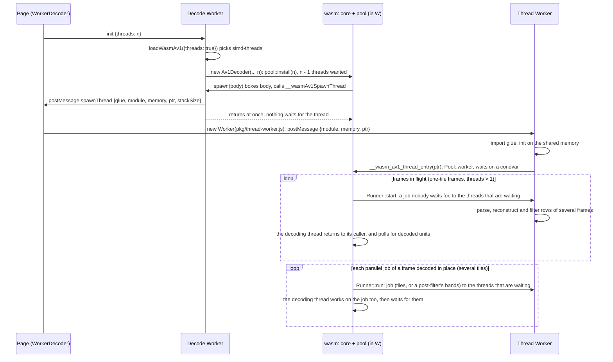

# wasm variants, detection and threading

> **Status:** PARTIAL — the four variants work, and decode on real threads in the threads builds, in Chromium, Firefox and WebKit; a stream with several tiles per frame gains little from more than four threads.
> **Owners (code):** `js/detect.js`, `js/loader.js`, `src/threads.rs`, `js/thread-worker.js`, `scripts/build.sh`, `tools/wasm-copy-guard`, `Cargo.toml`
> **Related docs:** [js-api-and-worker.md](./js-api-and-worker.md), [build-and-release.md](./build-and-release.md), [`../rivet-av1.md`](../rivet-av1.md), [`../performance.md`](../performance.md), [`../integration.md`](../integration.md)
> **Last verified against code:** 2026-11-13 @ the commit after `4aa6d72` (frames in flight)

## Overview

There are four builds of the same crate under `pkg/`, and the loader picks one
at run time. WebAssembly has no feature query, so detection validates tiny
modules that use exactly the instruction in question. The threads builds run
the decoder's parallel work on a pool of Web Workers sharing one
`WebAssembly.Memory`: the superblock rows of a one-tile frame behind its
parsing, the tiles of a frame of several, the loop filter, CDEF and loop
restoration, and several frames at once. That needs a cross-origin-isolated
page (COOP + COEP) and the decoder itself in a Worker, because the decoding
thread blocks on `memory.atomic.wait` while it waits for the others.

**What the variants buy, honestly.** Measured on 2026-11-13 with rivet-av1
(Node / V8, one Apple silicon machine): the SIMD variant is 1.6 to 2.7
times the baseline one on five 720p and 1080p clips. With threads, a
stream with one tile per frame, which is what most encoders produce below
4K, decodes 3.7 times as fast on eight threads as on one at 720p and 4.2
times at 1080p (175 / 308 / 477 / 652 and 85 / 158 / 258 / 360 frames per
second on 1 / 2 / 4 / 8 threads). rav1d, which 0.2.x used, reached 3.4 and
3.5 times on the same clips, from a lower one-thread rate: rivet-av1 is at
1.3 times its rate on eight threads. A stream encoded with eight tiles is
the other way round: 2.1 times on eight threads (178 / 286 / 380 / 372),
where rav1d reached 6.3, so 0.39 of its rate there. A frame of several
tiles is decoded as rivet-av1 did before, its tiles in parallel and its
post-filters in bands, one frame at a time. In the browsers (Playwright's
builds, the 720p clip, 1 / 4 / 8 threads): Chromium 168 / 404 / 595,
WebKit 145 / 363 / 451, Firefox 14 / 44 / 62.
[`../rivet-av1.md`](../rivet-av1.md) has the tables, and those of
2026-11-12, when a one-tile stream gained 1.2 to 1.3 times from eight
threads.

| Variant | Rust flags (`scripts/build.sh:100-107`) | Engines |
|---|---|---|
| `baseline` | rustc's default wasm32 features | Chrome 96, Firefox 89, Safari 15 |
| `simd` | `+simd128` | Chrome 91, Firefox 89, Safari 16.4 |
| `threads` | `+atomics,+bulk-memory,+mutable-globals`, shared imported memory (max 1 GiB), `-Zbuild-std`; then `tools/wasm-copy-guard` on the `.wasm` | + cross-origin isolation (Safari 15.2) |
| `simd-threads` | both | + cross-origin isolation |

## How it works today

### Interfaces

| Kind | Name | Notes |
|---|---|---|
| JS | `detectSimd()`, `detectBaseline()`, `detectThreads()` | `js/detect.js:13-81`; `detectThreads` also requires `SharedArrayBuffer`, `crossOriginIsolated` and `Worker` |
| JS | `chooseVariant({threads})` | SIMD first, then baseline; threaded only if asked and possible; `null` if nothing runs (`js/detect.js:91-96`) |
| JS | `loadWasmAv1({variant, threads, baseUrl, fetch})` | Imports `pkg/<variant>/wasm_av1.js` by URL; one cached runtime per `variant@baseUrl` (`js/loader.js:85-126`) |
| JS | `spawnThreadWorker(msg)`, `THREAD_STACK_SIZE` (2 MiB) | `js/loader.js:30`, `59-64` |
| Global | `globalThis.__wasmAv1SpawnThread(module, memory, ptr)` | Installed by the loader in whichever context instantiated a threads build (`js/loader.js:35-51`) |
| wasm export | `__wasm_av1_thread_entry(ptr)` | Runs one thread body (`src/threads.rs:63-69`) |
| wasm export | `threadsSupported()` | True in the two threads variants (`THREADS_SUPPORTED`, `src/lib.rs:52-55`); `Av1Decoder.threads()` is what a decoder got |

### Flow: a thread starting

The request goes up to the page rather than the decode Worker creating its
own child, because the decode Worker is about to block and Chromium only
starts a nested Worker once its parent returns to the event loop, and Safari
before 16.4 has no nested Workers (`js/loader.js:10-20`). On a page that
instantiates a threads build directly the loader spawns the Worker itself
(`js/loader.js:45-46`).

The wasm side is `src/threads.rs`. Natively rivet-av1 runs its parallel
work on threads of its own; a Worker cannot be started from Rust, so
`mod pool` (`82-291`) keeps Workers instead. `install(threads)` (`270-290`),
called when a decoder opens with more than one thread (`src/core.rs:62-66`),
registers the pool once as rivet-av1's `av1::parallel::Runner` and asks for
Workers until the instance has `threads - 1`; each runs `Pool::worker`
(`147-191`) for ever. The runner has two entry points:

- `Runner::run` (`195-227`) publishes a job, wakes the waiting workers,
  runs the job on the calling thread too, and returns when every worker
  that took part has left it. A job is a loop over a shared queue, so a
  Worker that has not come up yet is simply not waited for, and the first
  frames of a stream decode on fewer threads than asked for rather than
  later. This is how a frame that is decoded in place is threaded (a frame
  of several tiles, and everything when frames in flight is off).
- `Runner::start` (`229-264`) takes a job nobody waits for and gives it to
  the Workers that are waiting at that moment; rivet-av1 asks again later
  for those that had not come up. This is what frames in flight run on:
  the Workers go on decoding while the decoding thread is back in its
  caller, between two `run()` calls. The job ends when rivet-av1 says so
  (before it decodes anything in place, on a reset, when the decoder is
  dropped), and until every call of it has returned the pool takes no
  other job.

The pool outlives every decoder: a flush (`Decoder::reset`) or a second
decoder on the instance starts nothing. Two decoders decoding at once on
two threads of one instance share it by turns: the one that finds the pool
busy, with another's job or another's frames in flight, does its work
alone (`198-204`). Mutexes and condvars are std's, which on wasm with
atomics are `memory.atomic.wait` / `notify`; no dependency supplies them.

**Frames in flight.** `src/core.rs` (`new_decoder`, `49-59`) turns it on
for every decoder with more than one thread: as many frames as threads, at
most 8, and at most 8 × 1920 × 1088 luma samples between them, so eight
frames at 1080p and two at 4K. Each frame in flight holds its own buffers
(some 20 bytes a luma sample at 4:2:0), which bounds it at about 330 MB of
the 1 GiB a threads build may grow to. The cost is at the API: frames come
out a few temporal units after their unit went in, and the end of the
input is drained ([decoder-core.md](./decoder-core.md)). Because that
decoding happens while the decode Worker is idle, nothing wakes the
Worker when a frame is done: `js/worker.js` looks again every 4 ms while
`unitsInFlight` is not 0 and it has no input (`repoll`), so that a live
stream pushed unit by unit, with no end of stream, still delivers every
frame.

Thread count: `Av1Player` resolves `threads: 'auto'` to
`hardwareConcurrency` capped at 8 (`js/player.js:18-24`).

### Configuration

- Serve `pkg/` as static files; pass `baseUrl` if it is not next to `js/`
  (`js/loader.js:102`).
- The page must send `Cross-Origin-Opener-Policy: same-origin` and
  `Cross-Origin-Embedder-Policy: require-corp` for any threads variant
  ([`../integration.md`](../integration.md) covers serving).
- `opts.fetch` lets a caller add credentials to the `.wasm` request.

### Edge cases & gotchas

- **WebKit: `memory.copy` and `memory.fill` trap on memory another Worker
  grew (fixed 2026-11-13).** In JavaScriptCore, when one Worker grows a
  shared `WebAssembly.Memory`, an instance in another Worker keeps the old
  size: its `memory.size` returns it, and its `memory.copy` and
  `memory.fill` check bounds against it and trap ("Out of bounds memory
  access") on the grown pages. Loads, stores, atomic read-modify-writes,
  `memory.atomic.wait32` and `notify` on the same pages work, and so do two
  instances in one Worker. Only the instance's own `memory.grow` of a page
  or more brings it up to date (`grow(0)`, a failing grow and reading
  `memory.buffer` do not). Every decoder thread is an instance in its own
  Worker, any of them can grow the heap, and with bulk-memory (which shared
  memory requires) every `memcpy`/`memset` in the decoder is one of the two
  instructions, so with more than one thread a decode in WebKit died within
  the first frames: the decode Worker with "Out of bounds memory access"
  and then "recursive use of an object detected" on every later call, the
  thread Workers with the same trap in `Pool::worker`. That held for 0.2.0
  to 0.2.2 (rav1d) and 0.3.0 (rivet-av1) alike. Measured in Playwright's
  macOS WebKit 623.1.10 (Playwright 1.56, `webkit-2215`) on 2026-11-12;
  WebKit 626.1.1 (Playwright 1.62, `webkit-2336`) does not have it, and
  neither do Chromium or Firefox. Which Safari releases do was not tested.
  The bug cannot be avoided at compile time: wasm-ld refuses shared memory
  without `bulk-memory`, LLVM strips atomics without it, and in LLVM
  `bulk-memory` implies `bulk-memory-opt`, which is what lowers `memcpy` to
  `memory.copy`. So `scripts/build.sh` runs `tools/wasm-copy-guard` on the
  two threads variants after wasm-bindgen: every `memory.copy` and
  `memory.fill` becomes a call to a helper that runs the instruction when
  the range is within the instance's own `memory.size`, and otherwise
  copies or fills with 8-byte and 1-byte loads and stores. On an engine
  without the bug `memory.size` is always current, so every in-bounds call
  takes the instruction; on Chromium, bbb-720p decoded at the same speed
  guarded and unguarded (22.8 against 22.4 ms a frame on 8 threads, within
  the run-to-run spread). `test/copy-guard.test.mjs` holds both paths of
  the helpers to memmove/memset; `test/browser.mjs` reports whether each
  engine has the bug and plays the threads variants in all three.
- **Thread Workers end with the decoder (fixed 2026-11-13).** A pool worker
  never returns, by design, and the page creates it, so terminating the
  decode Worker does not end it. Until this fix nothing did: every threaded
  player that was destroyed left `threads - 1` Workers (up to 7) blocked on
  the shared memory, and the instance's heap with them. `WorkerDecoder` now
  keeps the Workers it starts and `close()` terminates them
  (`js/worker-client.js`, `threadWorkerCount`). Checked in headless Chromium
  through `test/browser.mjs` (the threads combinations still play); the
  Workers actually going away was not observed directly.
- **The fixtures here are one tile and tiny**, so the tests prove that the
  threads builds decode correctly on a pool of real threads, not that they
  are faster. The speed-up was measured separately on 720p and 1080p clips
  (above).
- **Several tiles per frame hold the threads back.** Such a frame is not a
  job of the engine that has frames in flight, and after one of them the
  next units are decoded in place too. An eight-tile 720p clip gains 2.1
  times from eight threads and nothing from the last four.
- **Memory with frames in flight** was bounded by arithmetic (about 330 MB)
  and not measured, at 4K or anywhere else. An allocation the 1 GiB heap
  cannot meet aborts the instance.
- **Two decoders on one instance**: while one has frames in flight the pool
  is its, and the other decodes on its own thread alone.
- A thread Worker that fails to import or traps logs to the console and the
  decoder may wait forever (`js/thread-worker.js:19-32`): a worker that never
  comes up is not waited for, one that dies inside a job is. Nothing
  surfaces it as an `error` message.
- A threads runtime instantiated on the main thread can only use 1 thread:
  the decoder would block the main thread. `Av1Player` without `worker: true` never
  asks for a threads build (`js/player.js:100`).
- The loader caches runtimes forever (`js/loader.js:24`); every decoder in a
  context shares one wasm instance and one memory, which grows and never
  shrinks.

## History & references

- 2026-11-13: the WebKit stale-size bug found and worked around
  (`tools/wasm-copy-guard`), above. decodeanywhere.dev's end-to-end suite
  found it, where it is marked as an expected failure in WebKit until a
  release carries the fix.
- 2026-11-13: frame threading. rivet-av1 `03054ad` decodes a one-tile
  frame's rows behind its parsing and several frames at once; the pool
  gained `Runner::start`, `src/core.rs` queues its units, and the decode
  Worker re-polls. `test/browser.mjs` has a live-push case for it (48
  units pushed on four threads with no end of stream, 48 frames expected):
  without the re-poll Firefox delivered 42 and WebKit 45.
- [`../rivet-av1.md`](../rivet-av1.md): the core, its `av1::parallel` hook
  (rivet-av1 `d041af0`) and wasm SIMD128 kernels (`3c2c549`, `c753ea1`),
  and every measurement.
- 0.3.0, 2026-11-12: rav1d removed. Until then the threads were rav1d's own
  (its fork's embedder spawner, `parking_lot_core`'s `nightly` parker), one
  set per decoder, its frame threading included.
- [`../performance.md`](../performance.md): what rav1d did with threads in
  the browsers (1080p from 16 ms to 3 ms a frame on 8 threads in Chromium),
  the baseline; and how the threads builds were made to work at all.
- `test/threads-node.mjs`, run by `test/decode.test.mjs`: both threads
  variants on 1, 2, 4 and 8 threads in Node, each wasm thread a
  `worker_threads` Worker, every fixture's MD5 before the Workers are up and
  after.

## Proposed / Ideas (backlog)

| Idea | Motivation | Sketch | Status |
|---|---|---|---|
| Report a dead thread | A hang becomes an error | `thread-worker.js` posts to the page; `WorkerDecoder` raises `onerror` | Proposed |
